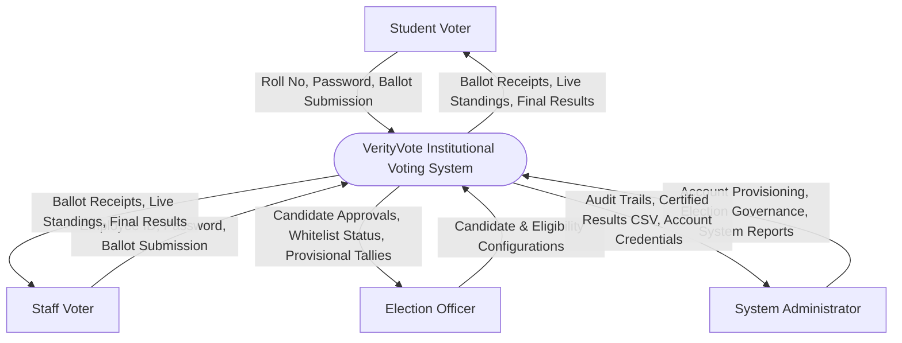

# Data Flow Diagrams (DFD) — VerityVote

## Level 0: System Context Diagram
The Level 0 context diagram demonstrates the boundary of VerityVote with institutional external actors (Students, Staff, Election Officers, System Administrators).

---

## Level 1: Process Decomposition
The Level 1 DFD decomposes the system into seven primary operational processes, identifying external entities, data stores, and data movements.

```mermaid
flowchart TD
    %% External Entities
    subgraph External_Actors ["Institutional Actors"]
        Student["Student / Staff Voter"]
        Officer["Election Officer"]
        Admin["System Administrator"]
    end

    %% Processes
    P1(["1.0 Authentication & Password Lifecycle"])
    P2(["2.0 Account Management & Bulk Import"])
    P3(["3.0 Election & Candidate Lifecycle"])
    P4(["4.0 Eligibility Whitelist Provisioning"])
    P5(["5.0 Transaction-Safe Voting Engine"])
    P6(["6.0 Results Aggregation & Reporting"])
    P7(["7.0 Security Audit Trail"])

    %% Data Stores
    D1[("D1: Users & Credentials")]
    D2[("D2: Login Attempts & Throttling")]
    D3[("D3: Elections & Candidates")]
    D4[("D4: Eligibility Whitelist")]
    D5[("D5: Participation Receipts")]
    D6[("D6: Anonymous Votes Box")]
    D7[("D7: Audit Ledger")]

    %% Authentication Flows
    Student -->|"Credentials (Roll No / Password)"| P1
    Admin -->|"Admin Credentials"| P1
    Officer -->|"Officer Credentials"| P1
    P1 <-->|"Verify hash, update auth_version"| D1
    P1 <-->|"Log attempts, check rate limit"| D2
    P1 -->|"Security events"| P7

    %% Account Management Flows
    Admin -->|"New user data / CSV registers"| P2
    P2 -->|"Create accounts, issue temp passwords"| D1
    P2 -->|"Account provisioning audits"| P7

    %% Election Management Flows
    Admin -->|"Election definitions"| P3
    Officer -->|"Candidate nominations & photos"| P3
    P3 <-->|"Store & enforce lifecycle locks"| D3
    P3 -->|"State change events"| P7

    %% Eligibility Flows
    Officer -->|"Assign criteria / IDs"| P4
    Admin -->|"Assign criteria / IDs"| P4
    P4 <-->|"Verify active status"| D1
    P4 -->|"Store whitelist mappings"| D4

    %% Voting Flows
    Student -->|"Cast candidate choice"| P5
    P5 <-->|"Verify active user & session version"| D1
    P5 <-->|"Verify open state & candidates"| D3
    P5 <-->|"Verify whitelist eligibility"| D4
    P5 <-->|"Row-lock: verify no prior participation"| D5
    P5 -->|"Store anonymous vote (No user_id)"| D6
    P5 -->|"Return cryptographic receipt"| Student
    P5 -->|"Log ballot participation (Redacted)"| P7

    %% Results Flows
    P6 <-->|"Tally valid ballots"| D6
    P6 <-->|"Fetch candidate profiles"| D3
    P6 <-->|"Calculate turnout"| D4
    P6 -->|"Provisional & final results"| Student
    P6 -->|"Certified CSV tallies"| Admin

    %% Audit Log Storage
    P7 -->|"Store immutable events"| D7
```

