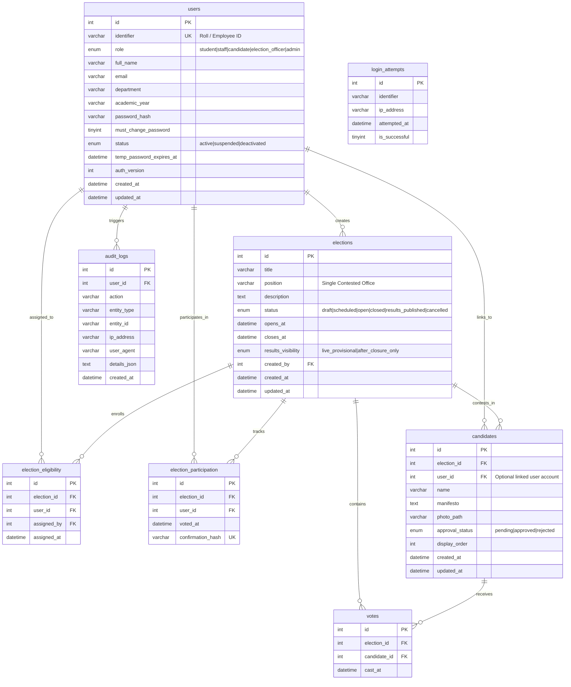

# Entity-Relationship Diagram (ERD)

This document visualizes the complete relational data model of the VerityVote system.

## Architectural Cardinality Rules
1. **One-to-Many (`elections` &rarr; `candidates`)**: An election must have at least 2 approved candidates prior to transitioning to `open`.
2. **Many-to-Many via Whitelist (`users` &harr; `elections` through `election_eligibility`)**: A user can vote only in elections where an explicit whitelist mapping exists.
3. **Decoupled Ballot Box (`election_participation` vs `votes`)**: Participation is linked to `users(id)`, but individual choices in `votes` are linked only to `elections(id)` and `candidates(id)`, preserving voter ballot privacy.
