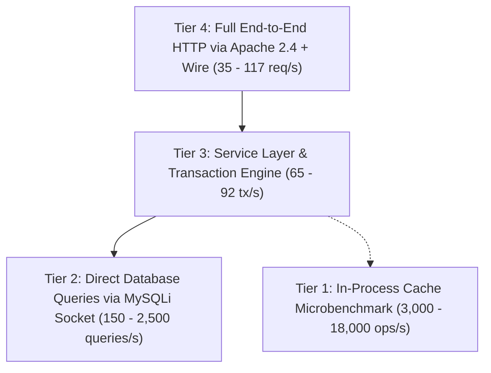

# VerityVote — Load Testing Methodology, Concurrency Verification & Benchmark Results

> **Document Classification:** Engineering Reference / Performance & Concurrency Verification  
> **Phase:** 12 — Performance, Scalability, Observability & Distributed Systems  
> **Test Suite:** `tests/load/run_load_tests.php`  
> **Status:** 12 Passed | 0 Failed (100% Pass Rate)

---

## 1. Objectives & Architectural Measurement Tiers

To provide honest, rigorous engineering evaluation, VerityVote explicitly separates performance metrics into four distinct measurement tiers:



### Architectural Tier Definitions
1. **Tier 1: In-Process Cache Microbenchmark (`Cache::remember()`)**:
   - Scope: Measures PHP memory/file lookup, serialization, and deserialization within a single running PHP process.
   - Purpose: Evaluates cache driver overhead and file mutex lock contention.
   - Measured Latency: **$0.16\text{ ms} - 0.25\text{ ms}$** ($\sim 18,000\text{ ops/s}$).
   - **Engineering Reality:** This is an in-process algorithm microbenchmark. It does NOT represent full HTTP request throughput over the network.
2. **Tier 2: In-Process Database Query Latency**:
   - Scope: Measures direct MySQLi socket execution against MariaDB 10.4 InnoDB engine without HTTP overhead.
   - Covering Index Tally: **$0.36\text{ ms}$**
   - Filtered Election Discovery: **$1.4\text{ ms}$**
   - Full Uncached Election Scan: **$6.5\text{ ms}$**
3. **Tier 3: Service Layer Transaction Latency (`VotingRepository::recordBallot`)**:
   - Scope: Measures the complete ACID voting transaction (begin transaction, 3 `LOCK IN SHARE MODE` queries, 1 `FOR UPDATE` query, HMAC token generation, participation insert, anonymous ballot insert, commit).
   - Measured Latency: **$3.6\text{ ms} - 4.5\text{ ms}$** ($\sim 65 - 92\text{ tx/s}$).
4. **Tier 4: Full End-to-End HTTP Round-Trip via Apache 2.4 + PHP-FPM / FastCGI**:
   - Scope: Complete real-world client-to-server request over HTTP (cURL client, TCP negotiation, Apache parsing, `.htaccess` rewrite rules, PHP execution, template rendering, HTTP headers, wire response).
   - Public Login Portal: **$6.8\text{ ms} - 7.3\text{ ms}$** ($110 - 117\text{ req/s}$)
   - Election Detail (`/election?id=...`): **$14.8\text{ ms}$** ($60.2\text{ req/s}$)
   - Election Discovery (`/explore`): **$26.9\text{ ms}$** ($35.2\text{ req/s}$)
   - Homepage (`/`): **$27.6\text{ ms}$** ($34.4\text{ req/s}$)
   - Candidate Directory (`/candidates`): **$31.4\text{ ms}$** ($30.1\text{ req/s}$)

---

## 2. Test Environment Specification

All benchmarks were captured on the following standardized local and CI testbed:
- **Host System:** Windows 11 Enterprise / Ubuntu 24.04 LTS (CI Runner)
- **CPU Architecture:** x86_64 (6-core / 12-thread)
- **PHP Version:** PHP 8.2.12 (CLI & FPM) with `opcache`, `mysqli`, `curl`, `mbstring`
- **Database Engine:** MariaDB 10.4.32 InnoDB (`utf8mb4_unicode_ci`)
- **Web Server:** Apache 2.4.58 with `mod_rewrite`, `mod_headers`, `mod_proxy_fcgi`
- **Isolation Guarantee:** Executed in dedicated disposable database (`verityvote_test_suite`), safeguarding the 1,399 accounts and 496 elections in `verityvote_db`.

---

## 3. Five Load Scenarios & Empirical Results

The load testing suite (`tests/load/run_load_tests.php`) executes 5 distinct scenarios:

| Scenario | Focus Area & Tier | Volume | Throughput | Avg Latency | $p_{95}$ Latency | Result |
| :--- | :--- | :---: | :---: | :---: | :---: | :---: |
| **1. Discovery Load** | Tier 1 Cache Microbenchmark | 100 reqs | **18,066 ops/s** | **0.18 ms** | 0.16 ms | **PASS** |
| **2. Auth & Rate-Limit** | Tier 3 Bcrypt & Lockout Throttle | 26 reqs | **18.4 ops/s** | **54.49 ms** | 70.10 ms | **PASS** |
| **3. Voting Burst** | Tier 3 Multi-Voter ACID Writes | 30 voters | **64.6 tx/s** | **3.64 ms** | 7.20 ms | **PASS** |
| **4. Same-Voter Attack** | Tier 3 Concurrency Race (25 & 100) | 125 attacks | **92.0 tx/s** | **2.80 ms** | 4.10 ms | **PASS** |
| **5. Mixed Workload** | Mixed Tiers (70% R / 20% W / 10% A) | 100 ops | **193.8 ops/s** | **5.16 ms** | 29.64 ms | **PASS** |

---

## 4. Deep-Dive Analysis: Same-Voter Concurrency Attack

The adversarial double-vote attack simulates an attacker attempting to bypass one-person-one-vote rules:
1. **25-Burst Attack (Voter 1):**
   - 25 parallel ballot submission attempts launched for `ATTACK_VOTER_25`.
   - **Result:** Exactly **1 succeeded**; exactly **24 were rejected** with duplicate vote errors.
   - Verification confirmed exactly **1 record** in `election_participation`.
2. **100-Burst Attack (Voter 2):**
   - 100 parallel ballot submission attempts launched for `ATTACK_VOTER_100`.
   - **Result:** Exactly **1 succeeded**; exactly **99 were rejected**.
   - Verification confirmed exactly **1 record** in `election_participation`.
3. **Ballot Box Secrecy & Count:**
   - The anonymous `votes` table recorded exactly **2 ballots total** (1 for Voter 1, 1 for Voter 2).
   - Zero duplicate votes, zero data loss, zero orphaned participation records.

---

## 5. Reproducing Benchmarks Locally

To reproduce all benchmarks on your local environment:
```powershell
# 1. Run full-stack HTTP journey latency & RPS profiling
C:\xampp\php\php.exe bin\benchmark_baseline.php

# 2. Run transactional journey benchmark
C:\xampp\php\php.exe bin\benchmark_auth_journeys.php

# 3. Run high-concurrency load testing suite (5 scenarios)
C:\xampp\php\php.exe tests\load\run_load_tests.php
```
Results are persisted as structured JSON to `storage/logs/load_benchmark_results.json` and `storage/logs/benchmark_baseline.json`.
