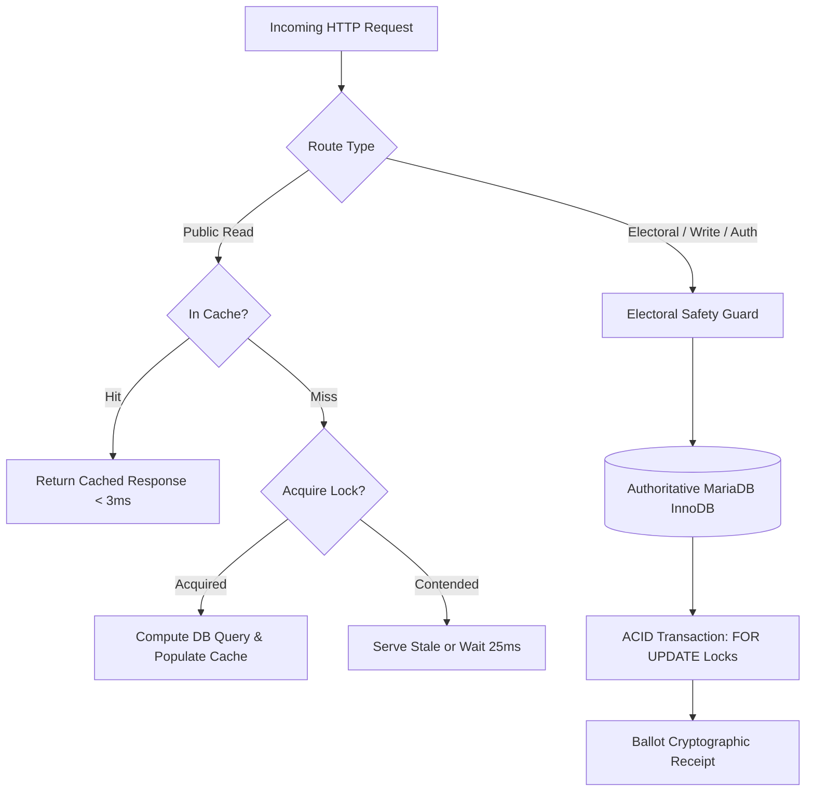

# VerityVote — Advanced Caching Architecture & Electoral Safety Boundaries

> **Document Classification:** Engineering Reference / Technical Architecture  
> **Phase:** 12 — Performance, Scalability, Observability & Distributed Systems  
> **Components:** `app/Core/Cache.php`, `app/Services/CacheService.php`  
> **Strategy:** Multi-tier Read-Aside with Anti-Stampede Mutex Locking & Probabilistic Refresh

---

## 1. Architectural Philosophy & Safety Invariants

In an electronic voting system, caching is an indispensable tool for scalability, but a catastrophic vulnerability if applied indiscriminately. 

### The VerityVote Cardinal Invariant
> **Authoritative electoral decision gates, voter identity whitelists, double-vote checks, and ballot commitments MUST NEVER touch a cache.**



### Invariant Rules Enforced in Code
1. **Forbidden Cache Key Guard:** `Cache::guardElectoralSafety(string $key)` throws a runtime exception if any key contains `voter`, `eligibility`, `participation`, `ballot`, `password`, `auth_token`, `csrf`, or `vote_cast`.
2. **Direct Authoritative Lookups:**
   - `AuthService::login`: Reads credentials, status, and auth version directly from `users`.
   - `EligibilityRepository::isEligible`: Directly queries `election_eligibility`.
   - `VotingRepository::recordBallot`: Begins an explicit InnoDB transaction with `FOR UPDATE` and `LOCK IN SHARE MODE`.

---

## 2. Multi-Driver Architecture

The caching subsystem provides driver abstraction via `CacheDriverInterface`:
- **`FileCacheDriver` (Default for Production Monolith):**
  - Atomic writes using temporary files and rename operations (`file_put_contents` + `rename`).
  - Hierarchical 2-character subfolder partitioning (`storage/cache/ab/abcdef...cache`) to prevent directory inode congestion when scaling to tens of thousands of cache entries.
  - OS-level shared read locks (`flock($fp, LOCK_SH)`) to avoid reading torn pages during concurrent writes.
- **`MemoryCacheDriver`:** Fast in-memory array store for unit and performance test cycles.
- **`NullCacheDriver`:** No-op bypass driver for test isolation and debugging.
- **Redis / Memcached Ready:** Clean driver interface allows plug-and-play Redis integration when moving to multi-server distributed clusters (Stage 3).

---

## 3. Cache Stampede (Thundering Herd) Prevention

When high-traffic items expire (such as an election detail view during peak campus turnout), hundreds of concurrent requests simultaneously attempt to recompute the same database query.

VerityVote employs a **Non-Blocking Mutex Lock with Stale-Serving Fallback**:
1. Upon cache miss, the thread attempts an exclusive non-blocking file lock (`flock(LOCK_EX | LOCK_NB)`).
2. **Lock Winner:** Proceeds to execute the expensive query, updates the cache, releases the lock, and returns the result.
3. **Contending Threads:** Rather than blocking or hammering MariaDB with redundant queries, contending threads sleep briefly (25ms) and re-check the cache. If populated, they return the freshly cached payload.

---

## 4. Cache TTL Policy & Invalidation Strategy

| Cache Domain | Key Pattern | TTL | Invalidation Trigger |
| :--- | :--- | :---: | :--- |
| **Public Election List** | `elections:query:{hash}` | 30s | Election created, status changed, or auto-synced. |
| **Election Detail** | `elections:detail:{id}` | 60s | Election edited, status transitioned. |
| **Candidate Profiles** | `candidates:election:{id}` | 120s | Candidate approved, profile edited, photo uploaded. |
| **Provisional Tallies** | `results:election:{id}` | 10s | Periodic TTL or election status transition to closed. |
| **Final Certified Results** | `results:election:{id}` | 3600s | Immutable once results are certified. |

### Explicit Invalidation Flow
When an administrator modifies an election via `ElectionService`:
```php
$this->cacheService->invalidateElection($electionId);
// Clears:
// 1. elections:detail:{id}
// 2. results:election:{id}
// 3. elections:query:*
```
When a candidate profile is updated via `CandidateService`:
```php
$this->cacheService->invalidateCandidates($electionId);
```
This ensures zero stale data while freeing the database from repetitive read traffic.
