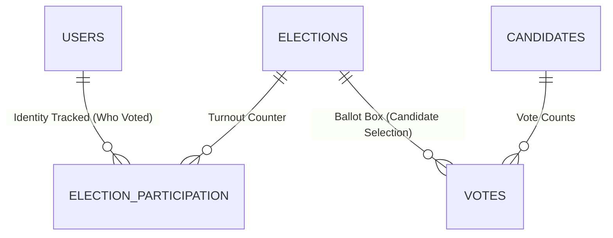

# VerityVote — Concurrency, Consistency & Transaction Engineering

> **Document Classification:** Engineering Reference / Technical Architecture  
> **Phase:** 12 — Performance, Scalability, Observability & Distributed Systems  
> **Primary Component:** `app/Repositories/VotingRepository.php`  
> **Database Engine:** MariaDB 10.4.32 / InnoDB  
> **Transaction Isolation Level:** `REPEATABLE READ` (Default InnoDB ACID)

---

## 1. Concurrency Challenges in Electronic Voting

In an institutional voting platform, the ballot box is a severe concurrency battleground:
1. **The Double-Vote Race Condition:** A voter opens multiple browser tabs or runs automated parallel scripts submitting conflicting ballots concurrently.
2. **The Lock Contention Bottleneck:** Thousands of voters cast ballots in the final minutes before closure, contending for identical rows in `elections` and `candidates`.
3. **Deadlocks (MariaDB Error 1213 / 1205):** If transactions acquire locks in inconsistent orders, the database engine aborts one or both transactions.
4. **Voter Privacy vs. Fraud Prevention Paradox:** The system must strictly prove whether a student has voted, without leaving any record linking the student to their chosen candidate.

---

## 2. Lock Ordering & Deadlock Elimination

To mathematically prevent deadlocks, VerityVote eliminates the **Circular Wait condition** (one of the four Coffman conditions for deadlocks) by establishing a **Strict Global Lock Order** across all database entities during ballot recording.

### Strict Resource Acquisition Sequence:
Every invocation of `VotingRepository::recordBallot` acquires locks in exactly the same sequence:

```
[1. elections (LOCK IN SHARE MODE)]
        │
        ▼
[2. candidates (LOCK IN SHARE MODE)]
        │
        ▼
[3. users (LOCK IN SHARE MODE)]
        │
        ▼
[4. election_eligibility (FOR UPDATE)]
        │
        ▼
[5. election_participation (INSERT with UNIQUE uk_participation_election_user)]
        │
        ▼
[6. votes (INSERT anonymous ballot into append-only table)]
        │
        ▼
[7. COMMIT transaction]
```

### Why `LOCK IN SHARE MODE` vs `FOR UPDATE`?
- **Read-Shared Rows (`elections`, `candidates`, `users`):**
  These rows are read by thousands of concurrent voters. Using `FOR UPDATE` would serialize the entire election to 1 voter at a time! Instead, `LOCK IN SHARE MODE` allows unlimited concurrent voters to read and verify election and candidate validity while preventing administrators from editing or closing the election during mid-ballot execution.
- **Exclusive Voter Row (`election_eligibility`):**
  Using `FOR UPDATE` on `(election_id, user_id)` locks only the specific voter's eligibility whitelist row. This serializes concurrent requests from the **same voter** while allowing all other voters to proceed in parallel without contention!

---

## 3. Exactly-Once vs. At-Most-Once Semantics

In distributed computing and electronic voting, the system must guarantee **Strict Exactly-Once Ballot Commitment**:
- **At-Most-Once is insufficient:** A voter whose vote is dropped or lost without receipt has suffered voter disenfranchisement.
- **At-Least-Once is unacceptable:** Allowing multiple ballots from one voter constitutes electoral fraud.

### How VerityVote Guarantees Exactly-Once:
1. **Database Level (Atomic Guarantee):**
   The unique constraint `UNIQUE KEY uk_participation_election_user (election_id, user_id)` ensures that at the physical database storage level, no second participation record can ever be inserted for the same election and user.
2. **Application Level (Idempotency Recovery):**
   If a network glitch or deadlock retry occurs:
   - On retry attempt ($attempt > 1$), `VotingRepository::recordBallot` checks whether a prior attempt already succeeded in inserting the participation record.
   - If found, it immediately and idempotently returns the voter's existing cryptographic confirmation receipt hash without inserting a second ballot into `votes`.

---

## 4. Bounded Deadlock Retries & Jittered Backoff

In high-concurrency environments, transient lock conflicts (MariaDB 1213 deadlock or 1205 lock wait timeout) can occasionally occur under intense row contention.

VerityVote handles this gracefully:
- **Bounded Attempts:** Maximum 3 attempts before safely aborting to prevent infinite thread spinning.
- **Immediate Rollback:** Aborts the current transaction immediately on deadlock detection, freeing all held locks.
- **Exponential Jitter Backoff:**
  $$\text{Backoff}(\mu\text{s}) = (2^{\text{attempt}} \times 10,000) + \text{random}(5000, 25000)$$
  - Attempt 1: Sleeps $25\text{ ms} - 45\text{ ms}$
  - Attempt 2: Sleeps $45\text{ ms} - 65\text{ ms}$
  - Random jitter desynchronizes contending threads, preventing retry stampedes.

---

## 5. Architectural Privacy Invariant: Two-Table Separation



1. **`election_participation`:** Contains `user_id`, `election_id`, `voted_at`, and `confirmation_hash`. It answers: *"Did Roll #CS101 vote?"* $\rightarrow$ YES.
2. **`votes`:** Contains only `election_id`, `candidate_id`, and `cast_at`. It answers: *"How many votes did Candidate Alice receive?"*
3. **No Foreign Key or Pointer between `election_participation` and `votes`:** Even a database administrator with full `root` access cannot mathematically correlate a specific voter to their chosen candidate.
