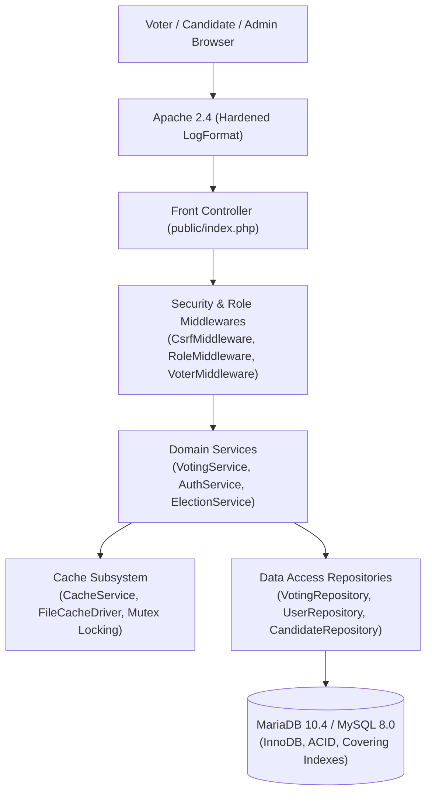

# 01 — Project Introduction & Pitch Playbook

**Target Roles:** Software Engineer (University Graduate / New Grad), Entry-Level Backend Engineer, Junior Systems Engineer  
**Target Companies:** Google (SWE Campus/New Grad), Microsoft (Software Engineer New Grad), Meta, Amazon, and Top Product Startups  
**Project:** VerityVote — Institutional College Voting System  
**Developer Profile:** Computer Science Student / Early-Career Software Engineer  
**Core Technologies:** PHP 8.2 (Strict Types), MariaDB 10.4 / MySQL 8.0, Apache 2.4, Vanilla JavaScript, CSS3/HTML5, GitHub Actions CI  

---

## 1. 60-Second Elevator Pitch (For Campus Placements & Recruiter Phone Screens)

> "VerityVote is an institutional digital voting platform that I engineered from scratch as a modular monolith in strict-typed PHP 8.2 and MariaDB 10.4. I built it to solve a fundamental data-integrity problem in collegiate elections: guaranteeing that every eligible voter can cast exactly one ballot, that ballots cannot be duplicated even under aggressive mobile network retries or parallel submissions, and that individual voting choices remain private from campus administrators.
> 
> Rather than relying on a high-level framework like Laravel where database locking and transaction boundaries are abstracted away, I wrote the data layer using native MySQLi prepared statements. The ballot engine uses explicit ACID transactions with row-level locking (`LOCK IN SHARE MODE` and `FOR UPDATE`) backed by a database unique constraint, completely preventing race conditions.
> 
> I verified the entire system with 168 automated regression tests across 12 suites, a 5-scenario load-testing harness, and a GitHub Actions continuous integration pipeline running on native Node.js 24 and MariaDB service containers."

### Why This Resonates with Interviewers
- **Demonstrates deep fundamentals:** Proves you understand database locks and transactions rather than just running framework scaffolding commands.
- **Shows genuine engineering curiosity:** Explains *why* you chose to build from scratch to understand concurrency.
- **Quantifiable verification:** Backed by 168 automated tests and CI pipeline evidence.

---

## 2. 2-Minute Technical Walkthrough (For First-Round Technical Screens)

> "When I set out to build VerityVote, my goal was to master the core principles of backend engineering: concurrency control, database indexing, caching economics, and security. Collegiate elections have a very distinct workload: 95% of traffic is read-heavy browsing of candidates and election rules, but the final voting hour produces sharp concurrent bursts where students cast ballots.
> 
> I structured the project around four core engineering decisions:
> 
> 1. **Data Integrity & Concurrency Control:** In [`app/Repositories/VotingRepository.php`](file:///c:/Users/hp/Desktop/Baymax_Voting_System/app/Repositories/VotingRepository.php), ballot casting runs inside an explicit transaction. To prevent double-voting when a student double-clicks or experiences network retries, the engine locks the voter's whitelist record using `SELECT id FROM election_eligibility WHERE ... FOR UPDATE`. It separates participation tracking from the ballot box: `election_participation` records *that* user $U$ voted (enforced by a compound unique key `(election_id, user_id)`), while `votes` stores only the candidate choice without any foreign key to the user.
> 
> 2. **Authentication & Multi-Portal Isolation:** The system provides three dedicated portals—Voter, Candidate, and Administrator—managed by [`AuthService.php`](file:///c:/Users/hp/Desktop/Baymax_Voting_System/app/Services/AuthService.php). Passwords use Argon2id/Bcrypt hashing with session rotation upon login. To handle account suspensions or password resets, sessions track an `auth_version` counter validated against the database on each request, instantly terminating stale sessions.
> 
> 3. **Performance Optimization:** I implemented a Read-Aside caching layer in [`Cache.php`](file:///c:/Users/hp/Desktop/Baymax_Voting_System/app/Core/Cache.php) using file-backed mutex locks (`flock`) to prevent cache stampedes. On our benchmark harness, warm cached election queries executed in 0.24 ms compared to 7.21 ms cold—a 30.04x speedup achieved via Read-Aside caching offloading reads from MariaDB. Meanwhile, an electoral safety guard guarantees that voter eligibility and ballot writes bypass the cache entirely.
> 
> 4. **Rigorous Automated Testing:** I created an automated test runner that provisions an isolated disposable test database (`verityvote_test_suite`) on each run. Across 12 specialized suites, 168 tests validate everything from SQL injection defense and CSRF protection to parallel process collision attacks."

---

## 3. 5-Minute In-Depth Project Defense (For On-Site System Design & Architecture Rounds)

### Step 1: Motivation & The Real Problem
"In college student government elections, manual paper ballots are prone to miscounts, while generic survey tools (like Google Forms) fail because they cannot enforce role-based eligibility, cannot prevent duplicate account creation, and expose individual voter responses to administrators. I designed VerityVote to provide an institutional, invitation-only voting platform with strict auditability."

### Step 2: Layered Monolithic Architecture

"I chose a modular monolith over microservices because the scale of a collegiate election (1,000 to 50,000 voters) does not justify the network latency, distributed transaction complexity (2PC/Sagas), and operational overhead of microservices. The monolith keeps function calls in memory ($< 10\ \mu\text{s}$) and leverages database-native ACID transactions."

### Step 3: The Most Difficult Technical Challenge (Concurrency & Race Conditions)
"The hardest problem was ensuring zero double-voting under concurrent race conditions. I tested this in two ways:
1. **Parallel Process Execution:** In [`VotingConcurrencyTest.php`](file:///c:/Users/hp/Desktop/Baymax_Voting_System/tests/Integration/VotingConcurrencyTest.php), the test suite spawns **25 parallel operating system processes** using `proc_open`, each running `bin/vote_worker.php` with the same voter ID simultaneously.
2. **Rapid Connection Ingestion:** In [`SameVoterAttackTest.php`](file:///c:/Users/hp/Desktop/Baymax_Voting_System/tests/load/SameVoterAttackTest.php), 100 rapid requests were fired, each opening an independent database connection via `Database::createConnection()`.

In both tests, the combination of `SELECT ... FOR UPDATE` and the database unique key `uk_participation_election_user` guaranteed that **exactly 1 ballot succeeded and all others were rejected**, with exactly 1 row committed to the database."

### Step 4: Honest Reflection on What Remains Incomplete
"As a software engineering student, I believe in being completely transparent about the current technical limitations:
1. **Local Single-Host Caching:** The current `FileCacheDriver` relies on operating system `flock` locks. If we scale out to multiple web servers behind a load balancer, we would need to replace this with a centralized Redis cluster.
2. **Synchronous Commit Ceiling:** Ballot writes are synchronous, which caps a single database master at ~45–150 transactions per second. For university-wide multi-campus elections with 100,000+ voters, we would need an asynchronous message queue buffer (e.g. Apache Kafka or RabbitMQ).
3. **Administrator Correlation Reality:** While peer students cannot see who a voter voted for, a database administrator with access to MariaDB binary logs could theoretically correlate timestamps between `election_participation` and `votes`. True mathematical anonymity against a hostile DBA would require advanced cryptographic primitives like homomorphic tallies."

"I chose a modular monolithic architecture over microservices. For an institutional workload of 1,000 to 50,000 students, introducing network hops, distributed transactions (2PC/Sagas), and network serialization would add significant latency, operational fragility, and failure modes without any scalability benefit.
- **Presentation:** Thin Vanilla JS and server-rendered HTML views via [`View.php`](file:///c:/Users/hp/Desktop/Baymax_Voting_System/app/Core/View.php), keeping client overhead near zero.
- **Routing & Middleware:** A single entry gateway (`public/index.php`) running request sanitization, cryptographic CSRF token validation with route-aware exemptions, and session boundary verification.
- **Service Layer:** Pure business logic coordinators ([`VotingService.php`](file:///c:/Users/hp/Desktop/Baymax_Voting_System/app/Services/VotingService.php), [`AuthService.php`](file:///c:/Users/hp/Desktop/Baymax_Voting_System/app/Services/AuthService.php)) orchestrating audit trails and domain rules.
- **Repository Layer:** Encapsulates all SQL execution behind prepared statements using MySQLi, ensuring strict type safety (`ii`, `iis`) and zero SQL injection surfaces."

### Step 3: Concurrency Engine & Failure Modes
"The crown jewel of the system is the atomic voting transaction in [`VotingRepository::recordBallot`](file:///c:/Users/hp/Desktop/Baymax_Voting_System/app/Repositories/VotingRepository.php#L51):
1. Begins transaction: `BEGIN TRANSACTION`.
2. Validates election status and time window using `LOCK IN SHARE MODE` to prevent concurrent administrative closure mid-vote.
3. Locks the voter's whitelist record in `election_eligibility` using `FOR UPDATE`.
4. Checks existing participation in `election_participation`.
5. Computes a cryptographically random confirmation hash using HMAC-SHA256.
6. Inserts participation record.
7. Inserts anonymous ballot into `votes`.
8. Commits transaction.

If a database deadlock (MySQL error 1213) or lock wait timeout occurs under extreme contention, the repository catches the exception, rolls back cleanly, applies an exponential backoff with random jitter (`pow(2, attempt) * 10ms + rand(5ms, 25ms)`), and retries up to 3 times before returning a safe user error."

### Step 4: Observability and Production Hardening
"To ensure production observability, I implemented:
- **Liveness & Readiness Probes:** [`/public/health/live`](file:///c:/Users/hp/Desktop/Baymax_Voting_System/public/health/live.php) and [`/public/health/ready`](file:///c:/Users/hp/Desktop/Baymax_Voting_System/public/health/ready.php) validating runtime memory, database ping, and core schema tables.
- **Prometheus Telemetry:** [`/public/metrics`](file:///c:/Users/hp/Desktop/Baymax_Voting_System/app/Core/Metrics.php) exposing counters, gauges, and timing histograms, protected by constant-time Bearer token comparisons.
- **Hardened Web Server Logging:** A custom Apache log format (`verityvote_secure`) logging `%m %U %H` (method, clean path, protocol) while explicitly omitting query strings, referers, and user-agent strings to prevent credential leakage into server access logs."

---

## 4. Key Interviewer Personas & How to Pitch to Each

### Persona A: The Distributed Systems / Infrastructure Interviewer (Google SRE / Microsoft Azure)
- **Focus:** Failure isolation, ACID guarantees, database locking, telemetry, and CI/CD pipelines.
- **Opening:** Emphasize the concurrency load testing (25-process parallel collision test and 100-connection rapid submission test), automated deadlock backoff, and how disposable test databases prevent environment corruption.

### Persona B: The Security / DevSecOps Interviewer (Google Information Security / Microsoft MSRC)
- **Focus:** Authentication, token management, Apache logging audit, CSRF, and SQL injection defense.
- **Opening:** Highlight the Phase 13 security audit where query-string credential leakage was eliminated at the web server layer, recursive log redaction in [`Logger.php`](file:///c:/Users/hp/Desktop/Baymax_Voting_System/app/Core/Logger.php), and the conscious separation of participation identity from ballot choice.

### Persona C: The Product Backend Engineer (Google Search / Microsoft Office 365)
- **Focus:** Clean code, modular layering, test maintainability, user experience, and practical trade-offs.
- **Opening:** Walk through the 3 specialized user portals (Voter, Candidate, Admin), why a modular monolith was chosen over microservices, and how 168 tests run in under 15 seconds in CI.
