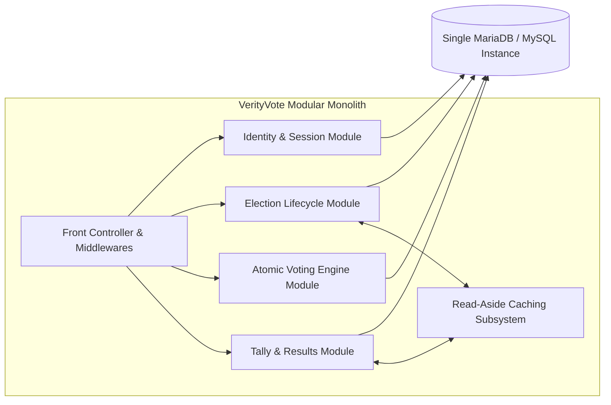
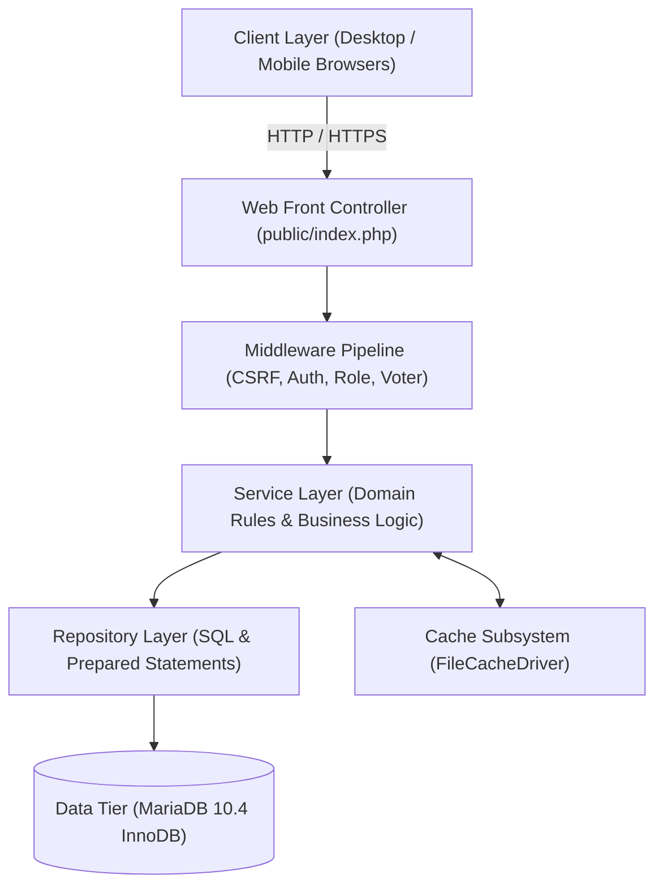
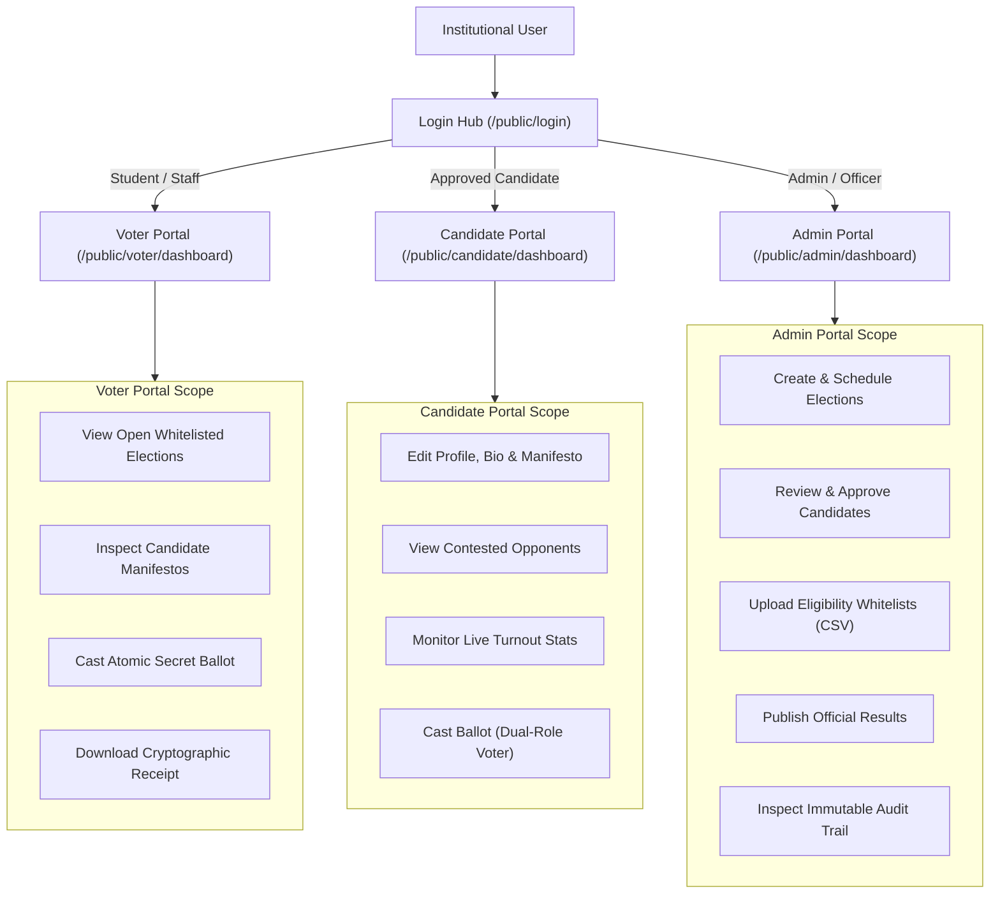
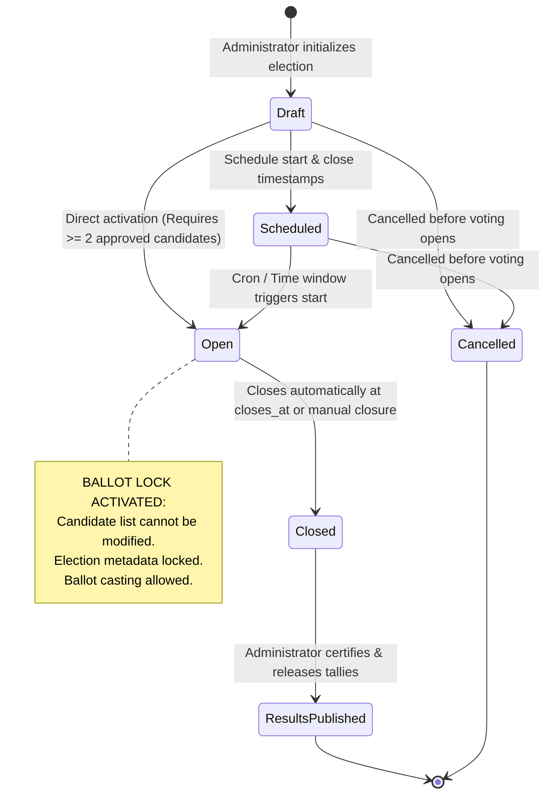
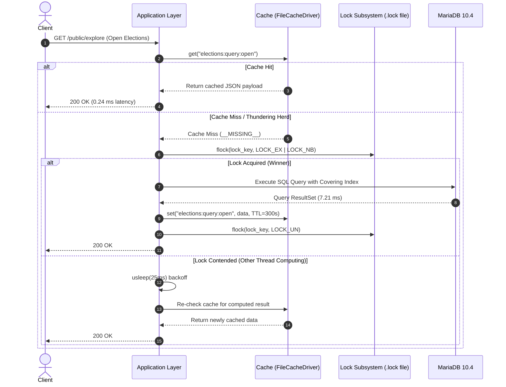
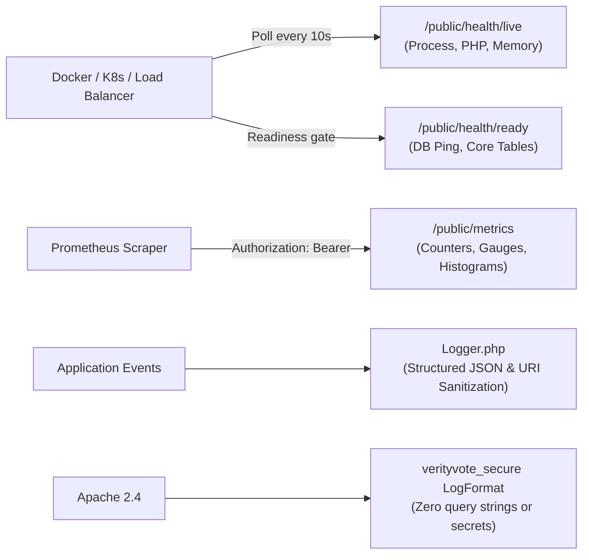

# 02 — System Architecture & Design Walkthrough

**Audience:** Software Engineers, System Architects, and Technical Interviewers  
**Subject:** High-Level & Component-Level Architecture of VerityVote  
**Repository References:** [`public/index.php`](file:///c:/Users/hp/Desktop/Baymax_Voting_System/public/index.php), [`app/bootstrap.php`](file:///c:/Users/hp/Desktop/Baymax_Voting_System/app/bootstrap.php), [`app/Core/`](file:///c:/Users/hp/Desktop/Baymax_Voting_System/app/Core/), [`app/Services/`](file:///c:/Users/hp/Desktop/Baymax_Voting_System/app/Services/), [`app/Repositories/`](file:///c:/Users/hp/Desktop/Baymax_Voting_System/app/Repositories/)  

---

## 1. Architectural Philosophy: The Modular Monolith

### 1.1 The Rationale for a Modular Monolith
In software engineering interviews, candidates often default to proposing microservices without justifying the operational overhead. VerityVote was deliberately designed as a **Modular Monolith**.

### 1.2 Comparison: Monolith vs. Microservices for Institutional Voting

| Decision Criterion | VerityVote Modular Monolith | Distributed Microservices Architecture |
| :--- | :--- | :--- |
| **Transaction Integrity** | **ACID compliant natively** via single-database InnoDB transactions (`BEGIN`, `COMMIT`, `ROLLBACK`). | Requires distributed 2-Phase Commit (2PC) or asynchronous Saga patterns; vulnerable to partial failures and network partitioning. |
| **Operational Simplicity** | Deploys as a single directory onto standard Apache/PHP hosting with zero container orchestration overhead. | Requires Kubernetes clusters, service meshes (Istio), API gateways, discovery registries, and message queues (Kafka/RabbitMQ). |
| **Latency Profile** | Function calls occur in memory ($< 10\ \mu\text{s}$ overhead); database queries execute over persistent socket connections. | Every inter-service hop adds HTTP/gRPC network latency ($2\text{--}15\ \text{ms}$) and JSON/Protobuf serialization overhead. |
| **Failure Surface** | Bounded failure modes (database up/down, web server responsive/unresponsive). | Cascade failures, circuit breakers required, split-brain scenarios under network netsplit. |
| **Team Velocity** | Single unified codebase, atomic Git commits, unified CI test suite completing in $< 15$ seconds. | Multiple repositories, version drift, contract testing (Pact), distributed tracing (OpenTelemetry/Jaeger) required. |

**Interview Defense:**  
*"For an institutional student voting platform serving up to 50,000 voters, microservices introduce unnecessary operational risk, network latency, and consistency problems. A well-structured modular monolith provides strong encapsulation between domain modules while leveraging database-native ACID transactions for absolute voting integrity."*

---

## 2. Multi-Tier Layered Architecture

VerityVote enforces a strict unidirectional four-tier layering pattern:

### 2.1 The Layers and Their Responsibilities

1. **Gateway / Front Controller Tier ([`public/index.php`](file:///c:/Users/hp/Desktop/Baymax_Voting_System/public/index.php))**:
   - Single entry point configured via Apache `mod_rewrite` rules.
   - Extracts and sanitizes request paths.
   - Starts secure session management via [`Session::start()`](file:///c:/Users/hp/Desktop/Baymax_Voting_System/app/Core/Session.php#L16).
   - Serves observability endpoints (`/health/live`, `/health/ready`, `/metrics`).

2. **Middleware Pipeline ([`app/Middleware/`](file:///c:/Users/hp/Desktop/Baymax_Voting_System/app/Middleware/))**:
   - `CsrfMiddleware`: Validates cryptographically random CSRF tokens on all state-mutating requests (`POST`, `PUT`, `DELETE`).
   - `AuthMiddleware`: Asserts that an authenticated session exists; redirects unauthorized visitors to the login gateway.
   - `RoleMiddleware`: Enforces institutional role boundaries (e.g. preventing students from accessing administrator controllers).
   - `VoterMiddleware`: Enforces voter eligibility and validates that voters cannot bypass account status checks.
   - `CandidateMiddleware`: Restricts candidate portal features to approved candidate profiles.

3. **Service Layer ([`app/Services/`](file:///c:/Users/hp/Desktop/Baymax_Voting_System/app/Services/))**:
   - Encapsulates pure domain logic independent of HTTP representations.
   - `VotingService`: Coordinates ballot acceptance, audit logging, and receipt dispatching.
   - `AuthService`: Manages Argon2id hashing, login throttling, lockout duration, and password rotation.
   - `ElectionService`: Manages election state transitions (Draft → Scheduled → Open → Closed → Results Published).
   - `ResultsService`: Aggregates tallies, detects ties, and calculates turnout percentages.
   - `CacheService`: Governs read-aside operations and invalidation logic.

4. **Data Access Repository Layer ([`app/Repositories/`](file:///c:/Users/hp/Desktop/Baymax_Voting_System/app/Repositories/))**:
   - Direct database access boundary.
   - Strictly uses MySQLi prepared statements with bound parameter types (`'i'`, `'s'`, `'ii'`).
   - Zero dynamic SQL string concatenation.
   - Owns transaction boundaries (`beginTransaction`, `commit`, `rollback`) for critical mutation workflows.

---

## 3. The Three Segregated Portals

Rather than mixing all user personas into a single monolithic dashboard, VerityVote separates user interaction into three distinct, dedicated portals:

### 3.1 Portal Identifier Mapping & Dual Roles
- **Portal Identifier Mappings (`portal_identifier_mappings`)**: Enables users to sign in using distinct aliases or portal-specific identifiers (e.g. an administrator logging in with `ADM_ROOT` vs their faculty roll number).
- **Dual-Role Candidates**: A student contesting an election as a candidate retains voter eligibility in elections where they are whitelisted. The system permits candidate login to edit manifestos while allowing the voter workflow to cast ballots without role pollution.

---

## 4. The Election Lifecycle State Machine

Elections progress through an immutable, strictly regulated lifecycle enforced by [`ElectionService.php`](file:///c:/Users/hp/Desktop/Baymax_Voting_System/app/Services/ElectionService.php):

### 4.1 Invariants Enforced at Each State Transition
1. **Draft → Open Transition Gate:**
   - Must have **at least two approved candidates**. If an election has 0 or 1 candidate, `ElectionService::openElection()` throws an exception preventing uncontested mock elections.
2. **Open State Ballot Lock:**
   - Once an election is `open`, [`CandidateService.php`](file:///c:/Users/hp/Desktop/Baymax_Voting_System/app/Services/CandidateService.php) strictly forbids adding, editing, or deleting candidates. The ballot configuration is permanently locked.
3. **Closed State Immutability:**
   - No ballots can be submitted once `closes_at` passes or the status is set to `closed`. Database transactions enforce this check using `LOCK IN SHARE MODE`.

---

## 5. Caching Subsystem Architecture

VerityVote implements a **Read-Aside (Cache-Aside)** pattern with anti-stampede mutex locks and strict electoral safety assertions.

### 5.1 Electoral Safety Invariant
In [`Cache::guardElectoralSafety(string $key)`](file:///c:/Users/hp/Desktop/Baymax_Voting_System/app/Core/Cache.php#L327), any key containing forbidden substrings (`voter`, `eligibility`, `participation`, `ballot`, `password`, `auth_token`, `csrf`, `vote_cast`) triggers an immediate fatal exception.
**Result:** It is mathematically impossible for stale voter eligibility or cached ballots to compromise election integrity.

---

## 6. Observability & Telemetry Architecture

The system incorporates production-grade observability components:

- **Liveness Probe ([`public/health/live.php`](file:///c:/Users/hp/Desktop/Baymax_Voting_System/public/health/live.php))**: Verifies PHP runtime execution and memory consumption.
- **Readiness Probe ([`public/health/ready.php`](file:///c:/Users/hp/Desktop/Baymax_Voting_System/public/health/ready.php))**: Verifies database connectivity and the presence of all 10 core tables before directing voter traffic to the node.
- **Prometheus Telemetry ([`public/metrics`](file:///c:/Users/hp/Desktop/Baymax_Voting_System/public/index.php#L72))**: Emits OpenMetrics-formatted metrics including ballot counters, cache hit/miss ratios, authentication lockouts, and query timings.

---

## 7. 5-Minute Architecture Walkthrough Script (For Interviews)

1. **State the Architecture Pattern:** "VerityVote is designed as a modular monolith organized into strict Presentation, Middleware, Domain Service, and Data Access layers."
2. **Explain the User Request Flow:** Trace a voter logging in, browsing candidate manifestos, and submitting a ballot.
3. **Highlight Concurrency Defenses:** Describe how `VotingRepository::recordBallot` uses row-level locking and isolated participation vs. ballot tables to defeat race conditions.
4. **Discuss the Caching Balance:** Explain how read-aside caching accelerates discovery by 30x while the electoral safety guard strictly forbids caching voting writes.
5. **Summarize Observability:** Conclude with the health check probes, Prometheus metrics, and hardened Apache logging format.
