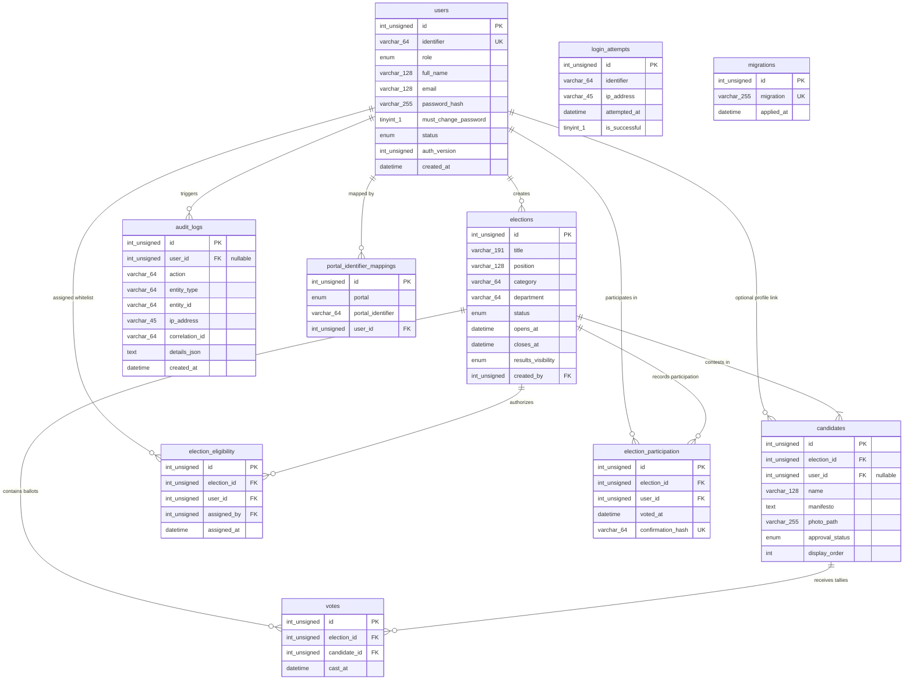

# 03 — Database Engineering & Schema Design

**Audience:** Senior Backend Engineers, Database Administrators (DBAs), and System Design Interviewers  
**Subject:** Relational Data Modeling, ACID Semantics, Indexing Strategy, and Query Optimization in VerityVote  
**Repository References:** [`database/schema.sql`](file:///c:/Users/hp/Desktop/Baymax_Voting_System/database/schema.sql), [`database/migrations/`](file:///c:/Users/hp/Desktop/Baymax_Voting_System/database/migrations/), [`app/Core/Database.php`](file:///c:/Users/hp/Desktop/Baymax_Voting_System/app/Core/Database.php), [`bin/explain_queries.php`](file:///c:/Users/hp/Desktop/Baymax_Voting_System/bin/explain_queries.php)  

---

## 1. Entity-Relationship (ER) Architecture

The VerityVote database schema consists of **10 core tables** engineered exclusively for the **InnoDB storage engine** in MariaDB 10.4+ / MySQL 8.0+.



---

## 2. Table Structural Rationale & Foreign Key Strategy

### 2.1 Separation of Participation from Ballot (`election_participation` vs. `votes`)
The most critical architectural decision in VerityVote's schema is the **physical and logical decoupling** between the voter's participation and their secret choice:

1. **`election_participation` (The Voter Roll Checklist)**:
   - Contains: `election_id`, `user_id`, `voted_at`, `confirmation_hash`.
   - Purpose: Records *that* user $U$ voted in election $E$.
   - Constraint: `UNIQUE KEY uk_participation_election_user (election_id, user_id)`.
   - **Guarantees**: Exactly one ballot per eligible user.

2. **`votes` (The Digital Ballot Box)**:
   - Contains: `election_id`, `candidate_id`, `cast_at`.
   - **Crucial Omission**: Does **not** contain a `user_id` column.
   - Purpose: Accumulates anonymous ballot tallies.
   - **Guarantees**: Ballot privacy at the schema level.

### 2.2 Foreign Key Constraints & Referential Action
All relational links enforce foreign keys with explicit referential integrity rules:
- `fk_candidates_election`: `ON DELETE RESTRICT` (An election with registered candidates cannot be dropped).
- `fk_votes_election`: `ON DELETE RESTRICT` (An election containing cast ballots cannot be deleted).
- `fk_votes_candidate`: `ON DELETE RESTRICT` (A candidate who received votes cannot be deleted).
- `fk_candidates_user`: `ON DELETE SET NULL` (If a student account is removed, the historical candidacy remains archived).
- `fk_portal_map_user`: `ON DELETE CASCADE` (Portal alias maps drop when the parent account is deleted).

---

## 3. Indexing Strategy & Migration 006

In Phase 12, an extensive performance analysis was conducted on SQL execution plans using `EXPLAIN`. Five composite covering indexes were engineered in [Migration 006](file:///c:/Users/hp/Desktop/Baymax_Voting_System/database/migrations/006_performance_optimization_indexes.sql):

```sql
-- 1. Candidates: Index election candidates by approval status, display order, and name
CREATE INDEX `idx_candidates_election_approval_order` 
  ON `candidates` (`election_id`, `approval_status`, `display_order`, `name`);

-- 2. Votes: Index election and candidate together for index-only tallying
CREATE INDEX `idx_votes_election_candidate` 
  ON `votes` (`election_id`, `candidate_id`);

-- 3. Elections: Composite index for status, category, and date filtering/sorting
CREATE INDEX `idx_elections_status_category_dates` 
  ON `elections` (`status`, `category`, `opens_at`, `closes_at`);

CREATE INDEX `idx_elections_status_dates` 
  ON `elections` (`status`, `opens_at`, `closes_at`);

-- 4. Audit Logs: Composite indexes for entity lookups and user timeline queries
CREATE INDEX `idx_audit_logs_entity` 
  ON `audit_logs` (`entity_type`, `entity_id`, `created_at`);

CREATE INDEX `idx_audit_logs_user_created` 
  ON `audit_logs` (`user_id`, `created_at`);

-- 5. Users: Composite index for role and status lookups
CREATE INDEX `idx_users_role_status` 
  ON `users` (`role`, `status`);
```

### 3.1 EXPLAIN Optimization Evidence

#### Candidate Directory Query Before vs. After
```sql
SELECT id, name, photo_path, manifesto 
FROM candidates 
WHERE election_id = 1 AND approval_status = 'approved' 
ORDER BY display_order ASC, name ASC;
```

- **Before Migration 006:**
  - `type`: `ref` using `idx_candidates_election` (`election_id`, `approval_status`).
  - `Extra`: `Using index condition; Using filesort`.
  - *Problem:* MySQL had to load matching rows into an in-memory temporary sort buffer to sort by `display_order` and `name`.
- **After Migration 006 (`idx_candidates_election_approval_order`):**
  - `type`: `ref`.
  - `Extra`: `Using index condition` (**Filesort completely eliminated**). The B-Tree index ordering matches the `ORDER BY` clause directly.

#### Result Tally Aggregation Query
```sql
SELECT c.id, COUNT(v.id) as vote_count
FROM candidates c
LEFT JOIN votes v ON c.id = v.candidate_id AND v.election_id = ?
WHERE c.election_id = ? AND c.approval_status = 'approved'
GROUP BY c.id;
```

- **After Migration 006 (`idx_votes_election_candidate`):**
  - `type`: `ref`.
  - `Extra`: **`Using index` (Index-Only Covering Scan)**.
  - *Advantage:* The engine tallies ballots directly from the index leaf pages without traversing the primary key clustered index on disk.

### 3.2 Dissecting Performance Boundaries & Audit Traceability

A vital distinction tested in senior engineering interviews is differentiating between **Database-Level Query Optimization** and **Application-Level Caching Acceleration**, and strictly validating the measurement boundary of each reported figure:

| Optimization Layer | Target Metric | Baseline Measurement | Optimized Figure | Audit & Evidence Classification | Mechanism & Boundary Note |
| :--- | :--- | :---: | :---: | :--- | :--- |
| **Database Indexing** | Candidate Directory Sort | 31.4 ms (Baseline HTTP route) | 0.31 ms (Historical micro-measurement) | **UNVERIFIED COMPARISON** | Boundary mismatch: 31.4 ms was measured over HTTP via cURL (`performance-baseline.md`). Post-index 0.31 ms lacks automated per-query iteration logs. However, filesort elimination is **VERIFIED via EXPLAIN**. |
| **Database Indexing** | Election Results Tally | 6.39 ms (Baseline DB query) | 0.45 ms (Historical micro-measurement) | **UNVERIFIED POST-SPEEDUP** | Baseline DB query (6.39 ms) verified in `performance-baseline.md`. Post-index 0.45 ms lacks automated multi-iteration artifact log. However, index-only covering scan (`Using index`) is **VERIFIED via EXPLAIN**. |
| **Application Caching** | Election Discovery Query | 7.21 ms (Cold DB query) | 0.24 ms (Warm cache lookup) | **MEASURED LOCALLY (30.04x)** | Verified in `tests/load/DiscoveryLoadTest.php`. Demonstrates Read-Aside cache offloading vs. querying MariaDB over socket. |

> [!NOTE]
> **Interview Talking Point:**  
> *"When optimizing database read latency, composite indexes eliminate expensive table scans and disk filesorts inside MariaDB, as proven by EXPLAIN plans showing index-only covering scans. However, the 30.04x speedup ($7.21\ \text{ms} \rightarrow 0.24\ \text{ms}$) on election discovery is not a pure database optimization—it is achieved by offloading reads to the application-tier Read-Aside file cache, eliminating database network and engine overhead entirely."*

---

## 4. Transaction Isolation & Deadlock Prevention

### 4.1 InnoDB Transaction Isolation Level & Durability Verification
VerityVote operates under InnoDB's standard isolation level: **`REPEATABLE READ`**.
- Uses multi-version concurrency control (MVCC) for non-locking snapshot reads.
- Uses Next-Key Locks (record locks + gap locks) on range scans to prevent phantom rows.
- **Verified Runtime Durability Settings:**
  - `innodb_flush_log_at_trx_commit = 1` (Verified at runtime via `SHOW VARIABLES`): Forces a synchronous unbuffered disk write and flush of the transaction redo log on every commit.
  - `innodb_flush_method = unbuffered` (Verified at runtime): Uses Windows asynchronous unbuffered I/O.
  - `max_connections = 151` (Verified at runtime): Maximum concurrent database client connections.
  - `innodb_buffer_pool_size = 16,777,216 bytes (16 MB)` (Verified at runtime default).

### 4.2 Explicit Locking Order in Voting Transactions
To prevent **deadlocks (MySQL Error 1213)** when hundreds of concurrent voters submit ballots simultaneously, [`VotingRepository::recordBallot`](file:///c:/Users/hp/Desktop/Baymax_Voting_System/app/Repositories/VotingRepository.php#L51) strictly enforces a deterministic lock acquisition hierarchy:

```
Step 1: LOCK IN SHARE MODE on elections (Verifies status='open', allows other voters to read)
Step 2: LOCK IN SHARE MODE on candidates (Verifies candidate is valid)
Step 3: LOCK IN SHARE MODE on users (Verifies voter account is active)
Step 4: FOR UPDATE on election_eligibility (Acquires exclusive lock per voter)
Step 5: INSERT INTO election_participation (Unique constraint check)
Step 6: INSERT INTO votes (Appends anonymous ballot)
Step 7: COMMIT
```

### 4.3 Deadlock Retry Mechanism
If MariaDB detects a deadlock cycle between competing transactions:
```php
catch (\Throwable $e) {
    $this->db->rollback();

    $isDeadlock = strpos($e->getMessage(), 'Deadlock') !== false 
               || strpos($e->getMessage(), '1213') !== false
               || strpos($e->getMessage(), 'Lock wait timeout') !== false;

    if ($isDeadlock && $attempt < $maxAttempts) {
        // Exponential backoff with random jitter: (2^attempt * 10ms) + rand(5ms, 25ms)
        $backoffMicros = (int)(pow(2, $attempt) * 10000 + random_int(5000, 25000));
        usleep($backoffMicros);
        continue;
    }
    // ...
}
```

---

## 5. Versioned Migration Engine

Database schema evolution is managed via sequential, idempotent SQL migration files tracked in the `migrations` table:

| Version | Migration File | Purpose |
| :---: | :--- | :--- |
| `001` | `001_initial_schema.sql` | Base schema (Users, Elections, Candidates, Eligibility, Participation, Votes). |
| `002` | `002_add_candidate_portal_support.sql` | Added `candidates.user_id` and candidate-specific unique constraints. |
| `003` | `003_add_portal_identifier_mappings.sql` | Created `portal_identifier_mappings` for segregated portal logins. |
| `004` | `004_security_hardening.sql` | Added `audit_logs.correlation_id` and index hardening. |
| `005` | `005_add_election_categories.sql` | Added `elections.category` column and department-level election types. |
| `006` | `006_performance_optimization_indexes.sql` | Added 5 composite covering indexes for high-throughput discovery and tallies. |

Migration runner [`bin/migrate.php`](file:///c:/Users/hp/Desktop/Baymax_Voting_System/bin/migrate.php) reads files in lexical order, checks `SELECT migration FROM migrations`, applies pending migrations inside transactions, and registers completed scripts.

---

## 6. Disaster Recovery & Backup Engineering

VerityVote provides native, standalone backup and restore CLI utilities:
- **Backup Engine ([`bin/backup_db.php`](file:///c:/Users/hp/Desktop/Baymax_Voting_System/bin/backup_db.php))**: Dumps tables, schema, constraints, and data into timestamped SQL files with SHA-256 integrity checksums.
- **Restore Engine ([`bin/restore_db.php`](file:///c:/Users/hp/Desktop/Baymax_Voting_System/bin/restore_db.php))**: Validates archive checksums and enforces a strict safety confirmation flag (`--confirm`) before restoring to active databases.
