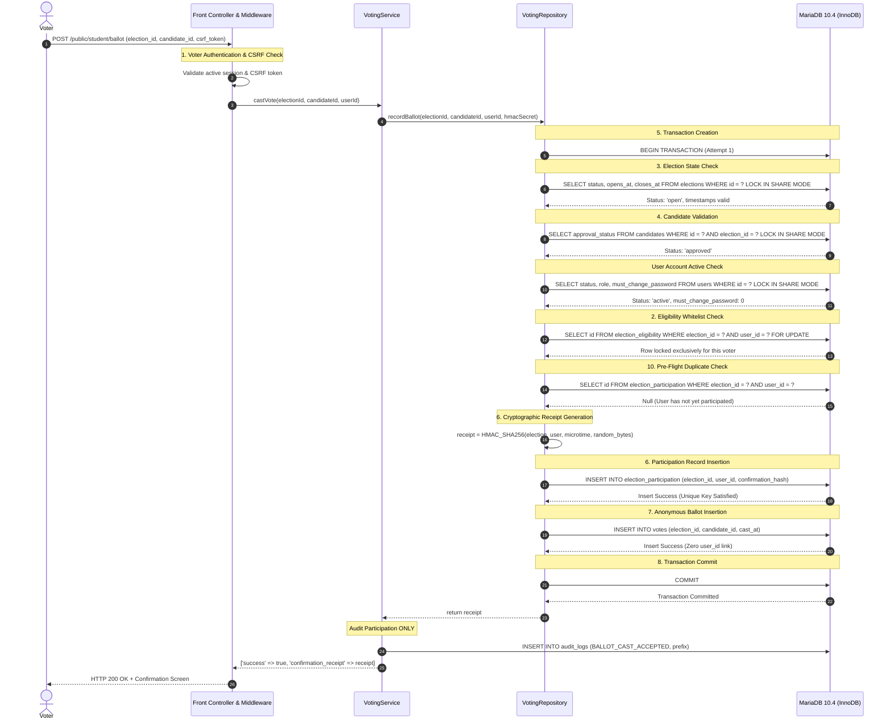
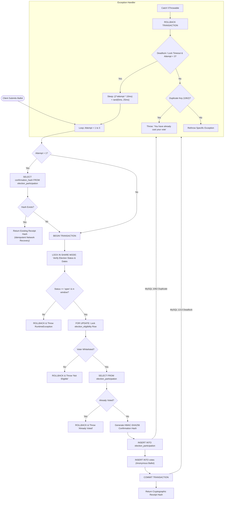

# 04 — Voting Concurrency & Transaction Deep Dive

**Audience:** Principal Software Engineers, Staff Systems Architects, and Concurrency Interviewers  
**Subject:** High-Concurrency Ballot Ingestion, Race Condition Defenses, ACID Transaction Lifecycles, and Network Idempotency  
**Repository Reference:** [`app/Repositories/VotingRepository.php`](file:///c:/Users/hp/Desktop/Baymax_Voting_System/app/Repositories/VotingRepository.php), [`app/Services/VotingService.php`](file:///c:/Users/hp/Desktop/Baymax_Voting_System/app/Services/VotingService.php)  

---

## 1. Executive Overview: The Concurrency Challenge

In institutional collegiate elections, voter behavior exhibits extreme burstiness. For example, during an election closing window, hundreds of students concurrently hit the submit button on mobile networks. If two identical requests from the same voter reach the web server within milliseconds of each other:
1. Both requests must not generate two separate ballots in the ballot box (double-voting).
2. The user must not receive an internal server error (500) or corrupt database state.
3. The system must guarantee **at-most-once accepted ballot recording** while providing **idempotent retry capabilities** in the event of dropped HTTP responses.

---

## 2. End-to-End Voting Flow (The 15 Steps)



### Detailed Breakdown of the 15 Steps

1. **Voter Authentication:** [`Session::start()`](file:///c:/Users/hp/Desktop/Baymax_Voting_System/app/Core/Session.php#L16) retrieves the authenticated `user_id`. [`AuthMiddleware`](file:///c:/Users/hp/Desktop/Baymax_Voting_System/app/Middleware/AuthMiddleware.php) asserts the session is valid, active, and matches the database `auth_version`.
2. **Election Eligibility Validation:** Queries `election_eligibility` to confirm the voter rolls include this student for this specific election.
3. **Election-State Validation:** Queries `elections` using `LOCK IN SHARE MODE` to ensure the status is `'open'` and current server time is strictly between `opens_at` and `closes_at`.
4. **Candidate Validation:** Queries `candidates` using `LOCK IN SHARE MODE` to confirm the candidate contests this election and is approved.
5. **Transaction Creation:** Invokes `$db->beginTransaction()`, pinning the session to a single transactional connection with `REPEATABLE READ` semantics.
6. **Participation Record Insertion:** Writes a row to `election_participation` with the voter's `user_id`, `election_id`, and cryptographic confirmation receipt hash.
7. **Ballot Insertion:** Writes an anonymous row to `votes` with `election_id` and `candidate_id` (strictly omitting `user_id`).
8. **Transaction Commit:** Issues `$db->commit()`, atomizing both writes permanently to the InnoDB redo log.
9. **Rollback Behavior:** If any step fails, `$db->rollback()` is triggered in the `catch` block, guaranteeing no partial records remain.
10. **Duplicate-Submission Protection:** Enforced at two layers: an application check in step 10, backed by an immutable database unique constraint:
    ```sql
    UNIQUE KEY `uk_participation_election_user` (`election_id`, `user_id`)
    ```
11. **Concurrent Requests from Same Voter:** If requests $R_1$ and $R_2$ arrive simultaneously, Step 4 (`FOR UPDATE` on `election_eligibility`) serializes them. The second request blocks until the first commits, then immediately encounters the participation record or triggers MySQL Error 1062 (Duplicate entry), resulting in a clean rejection.
12. **Concurrent Requests from Different Voters:** Voters $V_A$ and $V_B$ lock separate rows in `election_eligibility`. Both read shared locks on `elections` without blocking each other, enabling high parallel throughput.
13. **Database Deadlocks:** Under severe multi-voter contention, if a deadlock (MySQL error 1213) or lock wait timeout occurs, the engine automatically catches the error, rolls back, applies exponential backoff with random jitter, and retries up to 3 times.
14. **Connection Interruption During Commit:** If the client drops connection after the database commits but before receiving the HTTP response, the voter's second attempt detects the existing participation record and recovers the original receipt hash idempotently.
15. **Receipt Verification & Verification Invariant:** The voter is issued an HMAC-SHA256 receipt token, allowing independent proof of participation without exposing their candidate choice.

---

## 3. Transaction Flowchart & Exception Handling



---

## 4. Concurrency Test Mechanics: Parallel Processes vs. Multi-Connection Bursts

To verify race condition resistance, VerityVote implements two complementary concurrency test suites that test different layers of the execution stack:

### 4.1 Suite A: 25 True Parallel OS Processes (`VotingConcurrencyTest.php`)
In [`tests/Integration/VotingConcurrencyTest.php`](file:///c:/Users/hp/Desktop/Baymax_Voting_System/tests/Integration/VotingConcurrencyTest.php#L196) (Suite 4 of `tests/run_tests.php`):
- Spawns **25 parallel operating system child processes** using PHP's `proc_open()`.
- Each child process independently executes `bin/vote_worker.php <election_id> <candidate_id> <user_id>` simultaneously in the OS process table.
- Each process establishes its own TCP connection to MariaDB and races to execute `VotingRepository::recordBallot`.
- **Result:** Exactly 1 child process succeeds (emitting receipt), and 24 child processes fail with double-vote exceptions.
- **Database Proof:** MariaDB records exactly 1 participation record and exactly 1 ballot in `votes`.

### 4.2 Suite B: 100 Rapid Sequential Submissions over Separate Connections (`SameVoterAttackTest.php`)
In [`tests/load/SameVoterAttackTest.php`](file:///c:/Users/hp/Desktop/Baymax_Voting_System/tests/load/SameVoterAttackTest.php#L132) (Scenario 4 of `tests/load/run_load_tests.php`):
- Executes 100 rapid submissions in a sequential loop for the same voter ID.
- **Connection Model & Execution Reality:**
  - Rather than reusing a single database connection singleton, each iteration explicitly invokes `Database::createConnection()`.
  - This opens a **fresh, independent MySQLi socket connection** per submission, simulating connection churn and verifying that connection handles properly clean up and do not leak transactions.
  - **CRITICAL DISTINCTION:** This is **NOT** 100 simultaneous requests or parallel threads. It is 100 rapid sequential submissions across independent database connections in a single test process. Calling this test "100 simultaneous requests" is technically inaccurate.
- **Result:** Exactly 1 submission succeeds, 99 are rejected, and the database records exactly 1 participation record and 1 ballot row.

### 4.3 What a True 100-Client Concurrent Burst Test Would Require

In system design interviews, interviewers frequently probe:
> *"How would you test a true burst of 100 simultaneous voters hitting your web tier at the exact same millisecond?"*

VerityVote's current repository tests true concurrency at 25 parallel OS processes (Suite A) and connection integrity at 100 sequential connection cycles (Suite B). To execute a **true 100-client concurrent HTTP burst**, the test harness would require:

1. **External Distributed Load Generator:**
   An asynchronous multi-threaded load tool such as `k6`, `wrk`, or ApacheBench (`ab -n 1000 -c 100`) running on an independent machine or container pool to avoid CPU starvation between client and server.
2. **End-to-End HTTP Network Layer:**
   Requests must transit the full TCP/IP stack against Apache 2.4 VirtualHost, exercising:
   - OS TCP socket connection accept queue.
   - Apache worker thread allocation (`ThreadsPerChild 150` on Windows `mpm_winnt`).
   - In-process PHP thread execution (`php_module`) and filesystem session lock contention.
3. **Session & CSRF State Preparation:**
   Each of the 100 virtual clients must be provisioned with an authenticated session cookie and a valid CSRF token prior to the burst, firing simultaneously upon a coordinated trigger barrier.
4. **Observed System Constraints:**
   - At $c = 100$, Apache worker threads accommodate the load since $100 \le 150$ (`ThreadsPerChild`).
   - MariaDB active connections will spike to 100 ($100 < 151$ verified `max_connections`).
   - If concurrency exceeds configured worker threads or connection limits, incoming requests queue in the socket backlog or experience thread starvation, demonstrating the boundary where architectural buffering (Kafka/RabbitMQ) becomes necessary.
5. **Current Status in Repository:**
   True 100-client simultaneous HTTP concurrency is **unverified by end-to-end multi-client load testing** in the current repository. Suite A proves 25-process OS-level transactional safety; Suite B proves 100-connection rapid sequential deduplication.

### 4.4 Detailed Trace: Two Colliding Transactions ($T_1$ and $T_2$)

| Timestamp | Transaction $T_1$ (Winner) | Transaction $T_2$ (Loser) | Database State / Lock State |
| :---: | :--- | :--- | :--- |
| $t_0$ | `BEGIN TRANSACTION` | `BEGIN TRANSACTION` | Two active transactions initialized on distinct connections. |
| $t_1$ | `SELECT status FROM elections LOCK IN SHARE MODE` | `SELECT status FROM elections LOCK IN SHARE MODE` | Both acquire shared read locks (S-lock) on the election row. |
| $t_2$ | `SELECT id FROM election_eligibility WHERE user_id=42 FOR UPDATE` | `SELECT id FROM election_eligibility WHERE user_id=42 FOR UPDATE` | **$T_1$ acquires exclusive lock (X-lock) on voter's eligibility row.**<br>**$T_2$ is blocked and put into wait queue by InnoDB.** |
| $t_3$ | Checks participation: 0 rows found. | *(Blocked waiting for X-lock)* | |
| $t_4$ | `INSERT INTO election_participation` | *(Blocked waiting for X-lock)* | Participation recorded for user 42. |
| $t_5$ | `INSERT INTO votes` | *(Blocked waiting for X-lock)* | Anonymous ballot stored. |
| $t_6$ | **`COMMIT`** | *(Unblocked as $T_1$ releases X-lock)* | **$T_1$ completes successfully and returns confirmation hash.** |
| $t_7$ | *(Finished)* | **$T_2$ acquires X-lock and proceeds to step 5.** | |
| $t_8$ | *(Finished)* | `SELECT FROM election_participation` checks user 42. | **Row found! (Written by $T_1$ at $t_4$).** |
| $t_9$ | *(Finished)* | **`ROLLBACK`** | **$T_2$ throws RuntimeException: "You have already cast your vote".** |

### 4.5 What if the Application-Level Check Were Missing?
Even if an engineer completely removed the `SELECT FROM election_participation` query, the database unique key constraint provides an impenetrable secondary defense:
```sql
UNIQUE KEY `uk_participation_election_user` (`election_id`, `user_id`)
```
When $T_2$ attempts `INSERT INTO election_participation`, MariaDB aborts the statement with **`ERROR 1062 (23000): Duplicate entry '1-42' for key 'uk_participation_election_user'`**. The `catch` block catches error 1062 and rolls back the transaction cleanly.

---

## 5. At-Most-Once Ballot Recording vs. Exactly-Once Network Delivery

In distributed systems and backend interviews, a classic follow-up question is:
> *"Can you guarantee exactly-once execution over an unreliable network?"*

### The Theoretical Reality
Over an asynchronous network (the Internet), **true end-to-end exactly-once delivery is physically impossible** (The Two Generals Problem / FLP Impossibility). Packets can drop after the server commits the transaction but before the HTTP response reaches the browser.

### VerityVote's Architectural Solution
VerityVote achieves **At-Most-Once Ballot Acceptance** paired with **Idempotent Result Recovery**:

1. **At-Most-Once Acceptance:** Under no circumstances can a voter's ballot be recorded more than once in the `votes` table. The unique constraint on `(election_id, user_id)` guarantees this at the storage engine level.
2. **Idempotent Retry Recovery:**
   If a voter's network disconnects mid-flight, the voter refreshes the page or retries submission. On attempt 2+:
   ```php
   $existing = $this->getParticipation($electionId, $userId);
   if ($existing !== null && !empty($existing['confirmation_hash'])) {
       return $existing['confirmation_hash'];
   }
   ```
   Instead of failing with a confusing database error, the engine detects that the vote was already safely committed in attempt 1, bypasses ballot insertion, and returns the existing cryptographic confirmation receipt.
   - **Voter Experience:** Seamless receipt display without duplicate counting.
   - **System State:** Exactly 1 ballot counted; 1 participation recorded.
