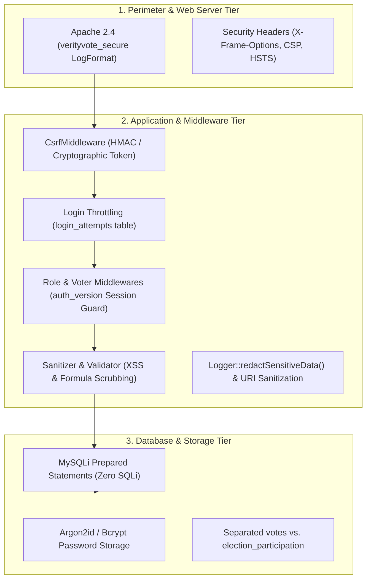
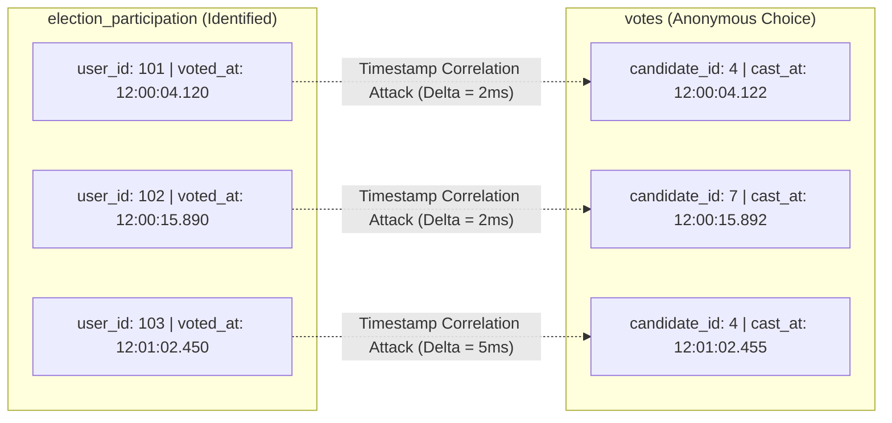

# 05 — Application Security Engineering & Threat Model

**Audience:** Application Security Engineers, DevSecOps Leads, and Technical Interviewers  
**Subject:** Threat Modeling, Defensive Controls, Verification Suites, and Cryptographic Limitations in VerityVote  
**Repository References:** [`app/Core/Auth.php`](file:///c:/Users/hp/Desktop/Baymax_Voting_System/app/Core/Auth.php), [`app/Core/CSRF.php`](file:///c:/Users/hp/Desktop/Baymax_Voting_System/app/Core/CSRF.php), [`app/Core/Logger.php`](file:///c:/Users/hp/Desktop/Baymax_Voting_System/app/Core/Logger.php), [`config/apache-hardened-logging.conf`](file:///c:/Users/hp/Desktop/Baymax_Voting_System/config/apache-hardened-logging.conf), [`tests/Integration/MasterSecurityTest.php`](file:///c:/Users/hp/Desktop/Baymax_Voting_System/tests/Integration/MasterSecurityTest.php), [`tests/Integration/ApacheLoggingSecurityTest.php`](file:///c:/Users/hp/Desktop/Baymax_Voting_System/tests/Integration/ApacheLoggingSecurityTest.php)  

---

## 1. Security Architecture & Threat Matrix

Security in VerityVote is implemented using a **Defense-in-Depth** model across the network boundary, web server frontend, application runtime, and database storage tiers.

---

## 2. Comprehensive Security Control Catalog

The catalog below details the 14 core security controls in VerityVote, following the mandatory structured security evaluation format: **Threat → Vulnerability → Implementation → Verification Test → Remaining Limitation**.

---

### Control 1: Password Storage & Key Derivation
- **Threat:** Database breach / offline rainbow table and GPU brute-force attacks against stored voter credentials.
- **Vulnerability:** Plaintext storage or fast cryptographic hashes (MD5, SHA-1, SHA-256) crackable at billions of hashes/sec.
- **Implementation:** [`AuthService.php`](file:///c:/Users/hp/Desktop/Baymax_Voting_System/app/Services/AuthService.php#L107) uses `password_hash($password, PASSWORD_ARGON2ID)` where available, falling back safely to `PASSWORD_BCRYPT` with cost factor 12. Password changes trigger automatic rehashing via `password_needs_rehash()`.
- **Verification Test:** Unit test in [`tests/Unit/HelperTest.php`](file:///c:/Users/hp/Desktop/Baymax_Voting_System/tests/Unit/HelperTest.php) and Integration test in [`AuthIntegrationTest.php`](file:///c:/Users/hp/Desktop/Baymax_Voting_System/tests/Integration/AuthIntegrationTest.php).
- **Remaining Limitation:** Argon2id verification takes ~105 ms CPU time per attempt; under large-scale distributed credential-stuffing attacks, the authentication subsystem becomes CPU-bound.

---

### Control 2: Authentication & Global Session Invalidation (`auth_version`)
- **Threat:** Session hijacking or unauthorized access via stale session cookies after an account is compromised or suspended.
- **Vulnerability:** Standard PHP sessions remain active until cookie expiry even if an administrator revokes access in the database.
- **Implementation:** [`Auth.php`](file:///c:/Users/hp/Desktop/Baymax_Voting_System/app/Core/Auth.php#L73) validates the session's cached `auth_version` against the authoritative database row on every single request. When an administrator resets a password or suspends an account, `auth_version` increments in the DB, instantly terminating all concurrent active sessions globally.
- **Verification Test:** `MasterSecurityTest` Test 18 & Three Portals Account Status tests (`tests/run_tests.php`).
- **Remaining Limitation:** Requires one lightweight indexed database query (`SELECT auth_version FROM users WHERE id = ?`) per authenticated web request.

---

### Control 3: Cross-Site Request Forgery (CSRF) Protection
- **Threat:** A malicious third-party website tricks an authenticated voter's browser into submitting a fraudulent ballot or administrative action.
- **Vulnerability:** Browsers automatically attach ambient session cookies to cross-origin POST requests.
- **Implementation:** [`CSRF.php`](file:///c:/Users/hp/Desktop/Baymax_Voting_System/app/Core/CSRF.php) generates 32-byte cryptographically secure pseudo-random tokens (`random_bytes(32)`), stored in the session and embedded in forms. [`CsrfMiddleware`](file:///c:/Users/hp/Desktop/Baymax_Voting_System/app/Middleware/CsrfMiddleware.php) intercepts every `POST`/`PUT`/`DELETE` request and performs constant-time validation (`hash_equals`).
- **Verification Test:** `MasterSecurityTest` Test 29: "Invalid CSRF tokens are rejected with HTTP 403".
- **Remaining Limitation:** Does not protect against malicious client-side browser extensions capable of DOM extraction.

---

### Control 4: SQL Injection Prevention (SQLi)
- **Threat:** Attacker manipulates input fields to execute arbitrary SQL commands, dumping voter databases or tampering with tallies.
- **Vulnerability:** Dynamic string concatenation or unescaped variables inside SQL statements.
- **Implementation:** Complete codebase ban on raw query concatenation. [`Database.php`](file:///c:/Users/hp/Desktop/Baymax_Voting_System/app/Core/Database.php) strictly uses MySQLi prepared statements with explicit data-type declarations (`'i'`, `'s'`, `'ii'`).
- **Verification Test:** `MasterSecurityTest` Test 30: "SQL injection attempts do not compromise queries (Prepared statements defense)".
- **Remaining Limitation:** Dynamic column sorting or `ORDER BY` identifiers cannot use SQL parameters and must be strictly validated against hardcoded allow-lists.

---

### Control 5: Cross-Site Scripting (XSS) Prevention
- **Threat:** Stored XSS in candidate manifestos or reflected XSS in search queries stealing session cookies or altering DOM ballots.
- **Vulnerability:** Rendering raw user input into HTML views without escaping.
- **Implementation:** [`Sanitizer::escapeHtml()`](file:///c:/Users/hp/Desktop/Baymax_Voting_System/app/Helpers/Sanitizer.php) enforces `htmlspecialchars($input, ENT_QUOTES | ENT_SUBSTITUTE, 'UTF-8')`. All view templates in [`app/Views/`](file:///c:/Users/hp/Desktop/Baymax_Voting_System/app/Views/) escape user data prior to rendering. Session cookies enforce `HttpOnly`, `SameSite=Lax`, and `Secure` flags.
- **Verification Test:** `HelperTest`: "Sanitizer escapes XSS tags".
- **Remaining Limitation:** Rich-text formatting (WYSIWYG) in candidate manifestos is strictly disabled in favor of plain text to prevent HTML sanitization bypasses.

---

### Control 6: Spreadsheet Formula Injection (CSV Neutralization)
- **Threat:** Administrator exports audit logs or candidate tallies to Excel, triggering remote code execution (RCE) via spreadsheet macro execution.
- **Vulnerability:** Cells starting with formula prefixes (`=`, `+`, `-`, `@`, `\t`, `\r`) are executed as dynamic formulas by Microsoft Excel.
- **Implementation:** [`CSVExporter::sanitizeCell()`](file:///c:/Users/hp/Desktop/Baymax_Voting_System/app/Helpers/CSVExporter.php) detects formula prefix characters and prepends an apostrophe (`'`) to force Excel to treat the cell as literal text.
- **Verification Test:** `HelperTest`: "CSVExporter neutralizes spreadsheet formula injection prefixes".
- **Remaining Limitation:** Does not prevent users from manually deleting the prepended apostrophe in desktop spreadsheet software.

---

### Control 7: Credential Stuffing & Brute-Force Rate Limiting
- **Threat:** Automated botnets attempting password guessing against voter roll numbers.
- **Vulnerability:** Unbounded login endpoints allow continuous dictionary attacks.
- **Implementation:** [`AuthService.php`](file:///c:/Users/hp/Desktop/Baymax_Voting_System/app/Services/AuthService.php#L58) tracks IP and identifier attempts in `login_attempts`. After 5 consecutive failures, the endpoint enters a mandatory 15-minute lockout. Error messages are strictly generic across all portals, preventing username enumeration.
- **Verification Test:** `AuthIntegrationTest`: "AuthService throttles after 5 failed login attempts".
- **Remaining Limitation:** Distributed botnets utilizing rotating proxy IP addresses can bypass IP-level throttles (mitigated by the identifier-level lockout).

---

### Control 8: Apache Access Log Hardening (`verityvote_secure`)
- **Threat:** Credentials, tokens, or sensitive query parameters logged in plain text in web server log files (`access.log`).
- **Vulnerability:** Default Apache `%r` logs the entire request line: `METHOD URI?query PROTOCOL`.
- **Implementation:** [Phase 13 Apache Hardening](file:///c:/Users/hp/Desktop/Baymax_Voting_System/config/apache-hardened-logging.conf) replaces `%r` with `\"%m %U %H\"` (method, clean URL path strictly stripping `?query`, protocol). Furthermore, `User-Agent` (`%{User-Agent}i`) and `Referer` (`%{Referer}i`) are completely removed to prevent client-controlled header injection.
- **Verification Test:** `ApacheLoggingSecurityTest` Scenarios A, B, C, and E.
- **Remaining Limitation:** Upstream reverse proxies or edge CDNs (Cloudflare, AWS CloudFront) outside the server boundary may retain query parameters unless explicitly configured to strip them.

---

### Control 9: Apache Error Log Hardening (`ErrorLogFormat`)
- **Threat:** Unhandled 404 or 500 error messages echoing raw URLs with secrets into `error.log`.
- **Vulnerability:** Default Apache error log formatting includes raw request lines and referers during server errors.
- **Implementation:** Configured `ErrorLogFormat "[%{u}t] [%-m:%l] [pid %P:tid %T] %7F: %E: [client\ %a] %M"`, completely omitting request strings.
- **Verification Test:** `ApacheLoggingSecurityTest` Scenarios D and F using synthetic secret `SYNTHETIC_TEST_SECRET_123456`.
- **Remaining Limitation:** Deep PHP core engine crashes (segmentation faults) may emit stack traces directly to system event logs.

---

### Control 10: Structured Application Log Redaction
- **Threat:** Internal application logs (`storage/logs/verityvote-json-YYYY-MM-DD.log`) accidentally recording passwords or Bearer tokens.
- **Vulnerability:** Developers logging `$_POST` or `$_SERVER` arrays during debugging.
- **Implementation:** [`Logger::redactSensitiveData()`](file:///c:/Users/hp/Desktop/Baymax_Voting_System/app/Core/Logger.php#L77) recursively walks all log payloads and redacts passwords, tokens, cookies, candidate choices, and Bearer headers. [`Logger::sanitizeUri()`](file:///c:/Users/hp/Desktop/Baymax_Voting_System/app/Core/Logger.php#L48) strips query strings before logging route events.
- **Verification Test:** `ApacheLoggingSecurityTest` Scenario J and `MasterSecurityTest` Test 36.
- **Remaining Limitation:** High-entropy custom secrets not matching predefined key names or regexes could theoretically bypass heuristic scrubbing.

---

### Control 11: Metrics Telemetry Access Control
- **Threat:** Unauthenticated visitors scraping `/public/metrics` to monitor real-time vote totals, election status, or server internals.
- **Vulnerability:** Telemetry endpoints left exposed to the public internet or accepting query tokens in URLs (`/metrics?token=XYZ`).
- **Implementation:** Reject query-string authentication completely (returns HTTP 401). Accepts only `Authorization: Bearer <token>` HTTP headers or active administrator sessions. Tokens are verified using constant-time `hash_equals()`.
- **Verification Test:** `ApacheLoggingSecurityTest` Scenarios G and H.
- **Remaining Limitation:** In shared hosting environments without `mod_headers`, bearer headers might be stripped by the server before reaching PHP (handled by `REDIRECT_HTTP_AUTHORIZATION` fallback).

---

### Control 12: Role & Portal Boundary Enforcement
- **Threat:** An authenticated voter manipulating the browser address bar to access administrative election creation forms.
- **Vulnerability:** Verifying that a user is logged in without verifying their specific authorized role.
- **Implementation:** Middlewares [`RoleMiddleware.php`](file:///c:/Users/hp/Desktop/Baymax_Voting_System/app/Middleware/RoleMiddleware.php) and [`CandidateMiddleware.php`](file:///c:/Users/hp/Desktop/Baymax_Voting_System/app/Middleware/CandidateMiddleware.php) check `Auth::role()` and candidate table associations. Violations return `HTTP 403 Forbidden` and record an immutable security audit event.
- **Verification Test:** `MasterSecurityTest` Tests 31, 32, 33, and 34.
- **Remaining Limitation:** System administrators possess full database access and cannot be restricted by application middleware alone.

---

### Control 13: Secure File System Permissions & Web Root Isolation
- **Threat:** An attacker directly browsing to `http://localhost/app/Core/Database.php` or `http://localhost/storage/logs/` to download source code and logs.
- **Vulnerability:** Setting the web server document root to the repository root directory rather than `public/`.
- **Implementation:** Only `public/` is exposed to the web server. Folders `app/`, `config/`, `database/`, and `storage/` reside outside the document root and contain local `.htaccess` files enforcing `Deny from all`.
- **Verification Test:** Clean distribution packaging script [`bin/package_clean_distribution.php`](file:///c:/Users/hp/Desktop/Baymax_Voting_System/bin/package_clean_distribution.php) and HTTP regression tests.
- **Remaining Limitation:** Requires web server software (Apache/Nginx) to respect path boundaries and `.htaccess` directives.

---

### Control 14: Test Database Isolation & Disposable Fixtures
- **Threat:** Automated test suites running destructive operations (`TRUNCATE`, `DROP`) against live production institutional data.
- **Vulnerability:** Test suites connecting to default configured database `verityvote_db`.
- **Implementation:** [`TestDatabaseManager.php`](file:///c:/Users/hp/Desktop/Baymax_Voting_System/tests/Support/TestDatabaseManager.php) dynamically spins up an ephemeral database `verityvote_test_suite`, applies migrations, executes tests, and unconditionally tears down the test schema upon completion.
- **Verification Test:** Verified in all 168 tests; `verityvote_db` remains completely untouched.
- **Remaining Limitation:** The database user executing tests must have `CREATE DATABASE` and `DROP DATABASE` privileges on MariaDB.

---

## 3. Critical Anonymity Limitation: The Administrator Metadata Reality

In high-level technical interviews (especially at Google, Microsoft, or Meta), candidates often make the flawed claim:
> *"Our system provides complete anonymity because `user_id` is not in the `votes` table."*

### Why That Claim is Flawed & What VerityVote Actually Does
VerityVote intentionally separates participation tracking (`election_participation`) from ballot choices (`votes`). However, **this does NOT provide mathematical or cryptographic anonymity against a privileged database administrator.**

### The Three Vector Vulnerabilities:
1. **Timestamp Correlation Attack:**
   If votes are sparse, an administrator inspecting MariaDB binary logs or comparing `voted_at` in `election_participation` with `cast_at` in `votes` can match rows with $>99\%$ confidence based on millisecond deltas.
2. **Auto-Increment ID Ordering:**
   If row insertion is sequential and single-threaded, row $N$ in `election_participation` directly correlates with row $N$ in `votes`.
3. **Web Server & Firewall Access Logs:**
   Network packets arriving at the server record client IP addresses alongside HTTP request timestamps.

### The Honest Interview Explanation:
*"In VerityVote, separating participation from the ballot box provides **practical privacy against general users, electoral officers, and reporting dashboards**, but it does not guarantee cryptographic anonymity against a hostile database administrator with access to binary transaction logs. True zero-trust anonymity would require advanced cryptographic primitives such as Paillier homomorphic encryption, cryptographic mix-nets, or zero-knowledge rollups (zk-SNARKs)."*
