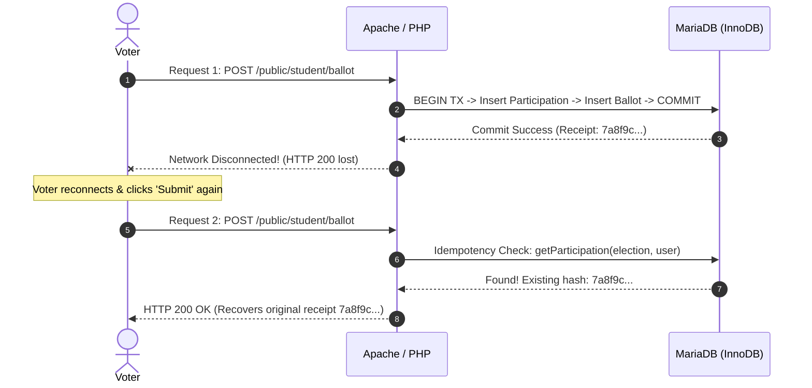

# 07 — Failure Mode Analysis & Fault Recovery

**Audience:** Site Reliability Engineers (SREs), Systems Architects, and Technical Interviewers  
**Subject:** Exhaustive Failure Mode and Effects Analysis (FMEA) across Infrastructure, Transactions, Caching, and Application Boundaries  
**Repository References:** [`app/Core/Database.php`](file:///c:/Users/hp/Desktop/Baymax_Voting_System/app/Core/Database.php), [`app/Repositories/VotingRepository.php`](file:///c:/Users/hp/Desktop/Baymax_Voting_System/app/Repositories/VotingRepository.php), [`app/Core/Cache.php`](file:///c:/Users/hp/Desktop/Baymax_Voting_System/app/Core/Cache.php), [`bin/restore_db.php`](file:///c:/Users/hp/Desktop/Baymax_Voting_System/bin/restore_db.php), [`tests/Integration/FailureResilienceTest.php`](file:///c:/Users/hp/Desktop/Baymax_Voting_System/tests/Integration/FailureResilienceTest.php)  

---

## 1. Failure Modes and Effects Analysis (FMEA) Matrix

The table below catalogs the 12 primary failure scenarios analyzed in VerityVote, contrasting **What the Application Actually Does Today** with **Future Enterprise Roadmap Improvements**.

| Failure Scenario | Severity | Detection Point | What VerityVote Actually Does Today | Future Roadmap Improvement |
| :--- | :---: | :--- | :--- | :--- |
| **1. Total Database Outage** | CRITICAL | Database connection initialization ([`Database.php`](file:///c:/Users/hp/Desktop/Baymax_Voting_System/app/Core/Database.php#L35)) | Throws safe `RuntimeException` without exposing credentials or internal hostnames. Readiness probe `/public/health/ready` returns HTTP 503. Front controller serves friendly 500 error view. | Automatic failover to secondary standby replica with DNS health-check switching. |
| **2. Mid-Transaction Failure** | HIGH | Inside `recordBallot` catch block ([`VotingRepository.php`](file:///c:/Users/hp/Desktop/Baymax_Voting_System/app/Repositories/VotingRepository.php#L180)) | Issues `$db->rollback()`. MySQL InnoDB undo log undoes uncommitted participation or ballot records. Zero orphan rows remain. | Outbox pattern with dead-letter queue (DLQ) for transaction reconciliation. |
| **3. Database Deadlock (1213)** | MEDIUM | `recordBallot` catch block | Catches error string `'Deadlock'` or `'1213'`. Rolls back transaction, computes exponential backoff with random jitter (`pow(2, attempt) * 10ms + rand(5ms, 25ms)`), retries up to 3 times. | Optimistic concurrency control (OCC) using row version numbers (`version` column). |
| **4. Lock Wait Timeout (1205)** | MEDIUM | `recordBallot` catch block | Rolls back transaction, retries with backoff. If 3 attempts exhaust, throws safe user-facing message: *"Ballot rejected: Concurrency conflict detected"*. | Dynamic statement timeout tuning (`SET SESSION innodb_lock_wait_timeout = 2`). |
| **5. Duplicate Ballot Submission** | LOW | Step 5 pre-check & DB unique key | Pre-check catches existing participation; if racing, DB unique key `uk_participation_election_user` rejects statement. Catches error 1062 and returns user error. | Client-side idempotency key header (`Idempotency-Key: <UUID>`) checked at API gateway. |
| **6. Election Closure Race Condition** | MEDIUM | Step 1 row lock in `recordBallot` | Uses `LOCK IN SHARE MODE` on the election row. If election closed 1 ms prior, transaction aborts with *"Voting has closed for this election"*. Zero ghost ballots accepted. | Two-phase closing: `closing_soon` warning state preventing new transactions 30s before hard closure. |
| **7. Filesystem Cache Corruption** | LOW | [`FileCacheDriver::get()`](file:///c:/Users/hp/Desktop/Baymax_Voting_System/app/Core/Cache.php#L69) | Catches serialization / decode failures (`@unserialize($content)`). Silently unlinks corrupt file and returns `__MISSING__`, seamlessly recalculating from database. | Cryptographic checksums (HMAC-SHA256) embedded in cache payloads to detect byte corruption. |
| **8. Cache Directory Unwritable** | MEDIUM | [`FileCacheDriver::__construct()`](file:///c:/Users/hp/Desktop/Baymax_Voting_System/app/Core/Cache.php#L33) | Gracefully falls back to direct database queries without throwing fatal exceptions. Logging records warning. | In-memory fallback (`ArrayCacheDriver`) during filesystem degradation. |
| **9. Malformed / Tampered Request** | LOW | [`Validator.php`](file:///c:/Users/hp/Desktop/Baymax_Voting_System/app/Helpers/Validator.php) & Middleware | Negative election IDs, non-numeric values, or oversized payloads rejected before database layer. Returns HTTP 400 Bad Request. | JSON Schema request validation at the front controller boundary. |
| **10. Authentication Failure** | LOW | [`AuthService.php`](file:///c:/Users/hp/Desktop/Baymax_Voting_System/app/Services/AuthService.php#L107) | Records failure in `login_attempts`. Returns generic error message preventing user enumeration. Enforces 15-minute lockout after 5 failures. | CAPTCHA / Proof-of-Work challenge upon 3rd failed attempt. |
| **11. Metrics Secret Missing / Wrong** | LOW | [`public/index.php`](file:///c:/Users/hp/Desktop/Baymax_Voting_System/public/index.php#L72) | Rejects request with HTTP 401 Unauthorized. Constant-time comparison prevents timing attacks. Authorizes valid administrator sessions. | Mutual TLS (mTLS) certificate authentication for Prometheus scrapers. |
| **12. Backup Restoration Failure** | HIGH | [`bin/restore_db.php`](file:///c:/Users/hp/Desktop/Baymax_Voting_System/bin/restore_db.php#L45) | Requires explicit `--confirm` flag to prevent accidental overwrite. Validates SHA-256 archive checksum before execution. | Automated staging environment restoration verification via CI/CD cron pipeline. |

---

## 2. In-Depth Failure Case Studies

### 2.1 Case Study: The Mid-Stream Network Drop
**The Scenario:** A student votes from a smartphone on a campus Wi-Fi edge. The phone sends the ballot request. The server acquires locks, inserts the participation record, inserts the ballot, and commits the transaction. At that exact millisecond, the student enters an elevator, dropping their Wi-Fi connection. The HTTP 200 response never reaches the browser.



**How VerityVote Handles It:**
1. The ballot was committed cleanly; no rollback was required.
2. When the student reconnects and resubmits or refreshes the page, `VotingRepository::recordBallot` runs its retry idempotency check:
   ```php
   if ($attempt > 1) {
       $existing = $this->getParticipation($electionId, $userId);
       if ($existing !== null && !empty($existing['confirmation_hash'])) {
           return $existing['confirmation_hash'];
       }
   }
   ```
3. The original cryptographic confirmation receipt is returned cleanly. The database ballot count remains exactly 1.

---

### 2.2 Case Study: The Midnight Election Closure Collision
**The Scenario:** An election closes at `2026-11-07 23:59:59`. At `23:59:58.950`, a voter clicks submit. While the ballot transaction is in-flight, an administrator issues a close command, or the server clock ticks to `00:00:00`.

**How VerityVote Handles It:**
1. In `VotingRepository::recordBallot`, step 1 executes:
   ```sql
   SELECT id, status, opens_at, closes_at FROM elections WHERE id = ? LOCK IN SHARE MODE
   ```
2. If the administrator attempts to update the election status (`UPDATE elections SET status = 'closed'`), the administrator's transaction requires an **Exclusive Lock (X-lock)** on the election row.
3. Because the voter's transaction holds a **Shared Lock (S-lock)**, the administrative update is safely queued behind the active ballot transaction.
4. If the server time has passed `closes_at` when the voter's transaction checks `$now > $closesAt`, the code immediately executes:
   ```php
   throw new RuntimeException("Voting has closed for this election.");
   ```
5. The catch block issues `$this->db->rollback()`, preventing any ghost ballots from entering the certified tally after the deadline.
