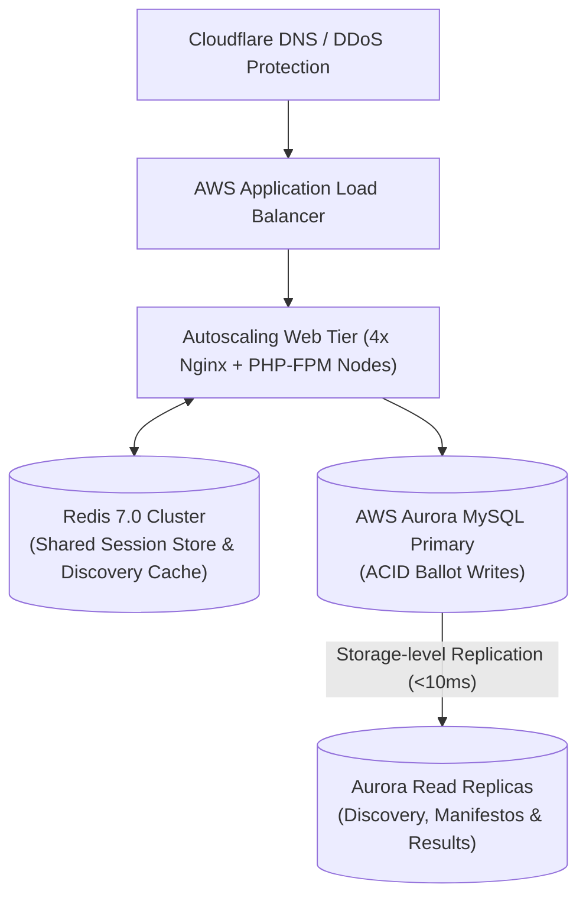
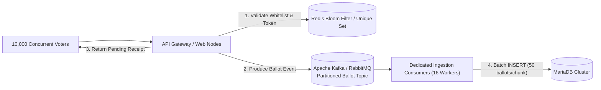
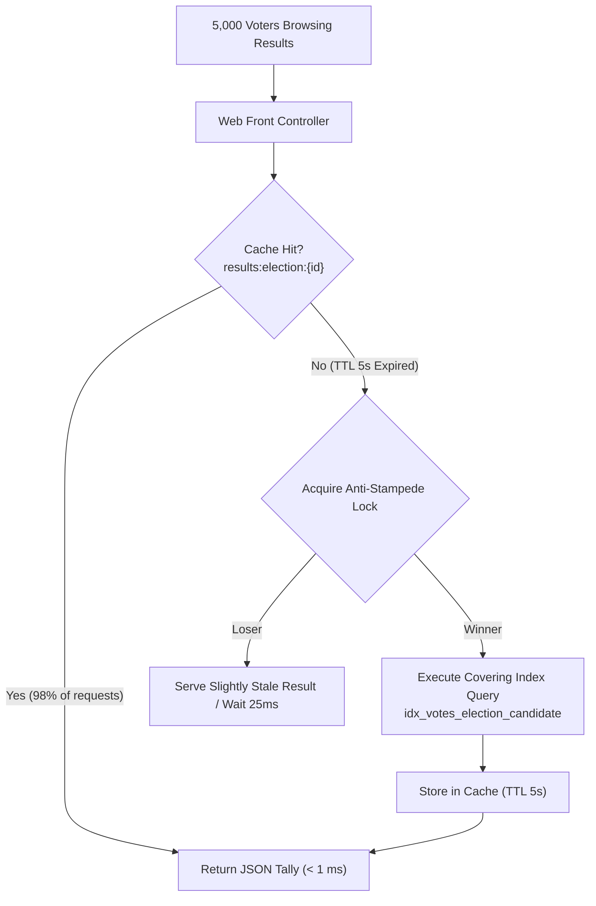
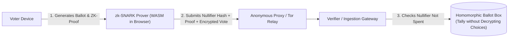

# 09 — System Design Interview Scenarios & Solutions

**Audience:** System Design Candidates, Staff Software Engineers, and Technical Interviewers  
**Format:** 10 Comprehensive System Design Scenarios with Functional/Non-Functional Specs, Architecture, Data Models, API Contracts, Bottlenecks, and Evolutionary Scalability Paths  

---

## Scenario 1: Design a College Voting Platform for 10,000 Students

### 1. Requirements
- **Functional Requirements:**
  - Whitelisted student accounts can log in securely.
  - Voters can view active elections and approved candidate manifestos.
  - Voters can cast exactly one ballot per election.
  - Voters receive an immutable cryptographic confirmation receipt.
  - Administrators can certify and publish official results.
- **Non-Functional Requirements:**
  - Zero double-voting under concurrent attempts.
  - Sub-second page load times for election discovery ($< 200\ \text{ms}$).
  - Ballot casting latency $< 50\ \text{ms}$.
  - High availability during the 8-hour voting window ($99.9\%$).

### 2. Architecture & Data Model
- **Architecture:** Monolithic application deployed on Apache 2.4 + PHP 8.2 with MariaDB 10.4 InnoDB storage engine and file-backed Read-Aside caching.
- **Data Model:** Core tables: `users`, `elections`, `candidates`, `election_eligibility`, `election_participation`, `votes`.
- **API Design:**
  - `POST /public/login`: Form-encoded `{identifier, password, csrf_token}` → Session Cookie
  - `GET /public/explore`: Returns cached list of open elections (TTL = 300s)
  - `POST /public/student/ballot`: `{election_id, candidate_id, csrf_token}` → `{success: true, receipt: "..."}`

### 3. Bottlenecks & Existing vs. Proposed
- **Existing Implementation:** Fully implemented in VerityVote. An eligible electorate of 10,000 students voting across an 8-hour window ($28,800\ \text{s}$) averages only $\approx 0.35\ \text{votes/sec}$, with peak rushes reaching $3\text{--}5\ \text{votes/sec}$. Comparing this arrival rate to VerityVote's measured single-process benchmark rate of **45.1 tx/sec** yields a nominal rate ratio of $9\times$ to $13\times$.  
  *Critical Concurrency Distinction:* This rate ratio does not establish production safety margin under true network concurrency. On Windows XAMPP Apache (`mpm_winnt`), worker threads are governed by `ThreadsPerChild 150`, meaning concurrent active web requests beyond 150 require load balancing or transition to an asynchronous queue buffer.
- **Proposed Scalability for Peak Spikes:** Transition to Linux Nginx + PHP-FPM or Apache event MPM; increase worker pools to 256+; tune MariaDB `innodb_buffer_pool_size` from default 16 MB to 2 GB.

---

## Scenario 2: Scale the Platform to 100,000 Voters (Multi-Campus University)

### 1. Requirements
- **Scale:** 100,000 total eligible voters; 10 distinct colleges; peak voting throughput of 150–300 votes/sec during the final hour.
- **High Availability:** Active-active multi-zone redundancy.

### 2. Architecture


### 3. Data Model & Sharding Strategy
- **Partitioning:** Partition `election_eligibility`, `election_participation`, and `votes` by `election_id` (Range / Hash Partitioning).
- **Session Management:** Offload PHP sessions from local disk to a replicated Redis cluster using Redis Sentinel.

### 4. Trade-offs
- **Existing vs. Proposed:** Current VerityVote uses single-host file cache. Transitioning to 100,000 voters requires replacing `FileCacheDriver` with `RedisCacheDriver` and separating read queries to Aurora replicas.

---

## Scenario 3: Handle 10,000 Simultaneous Voting Requests (Peak Spike Buffer)

### 1. Problem Statement
At 11:59 AM (1 minute before polls close), 10,000 students submit ballots within a 60-second window (~166 votes/sec, with initial 2-second burst of 2,000 req/sec). Direct synchronous database insertion would exhaust the MariaDB thread pool.

### 2. Architecture: Buffered Asynchronous Ingestion


### 3. Consistency vs. Latency Trade-off
- **Trade-off:** Voters receive an immediate cryptographic submission receipt while their ballot is asynchronously written to disk within 1–3 seconds.
- **Idempotency:** The Redis set `election:{id}:voted` records the `user_id` instantly via atomic `SADD`. If `SADD` returns 0, the gateway rejects the duplicate before touching Kafka.

---

## Scenario 4: Prevent Duplicate Ballot Recording under Severe Network Retry

### 1. The Core Threat
Mobile clients automatically retry HTTP requests when latency exceeds 2 seconds, generating 2–5 duplicate HTTP packets for a single user click.

### 2. Three-Layer Defense-in-Depth Architecture
1. **Layer 1: Client-Side UI Lock:** JavaScript disables submit buttons on click and shows loading spinner.
2. **Layer 2: Application-Level Idempotency Check:** Step 10 in `VotingRepository` checks `getParticipation(election_id, user_id)` before attempting write.
3. **Layer 3: Storage Engine Unique Key Constraint:**
   ```sql
   UNIQUE KEY `uk_participation_election_user` (`election_id`, `user_id`)
   ```

### 3. Verification Evidence
VerityVote verified this defense-in-depth model across two distinct automated test suites:
1. **25 Parallel OS Processes ([`VotingConcurrencyTest.php`](file:///c:/Users/hp/Desktop/Baymax_Voting_System/tests/Integration/VotingConcurrencyTest.php#L196)):** 25 operating system child processes spawned via `proc_open` racing simultaneously in the OS process table. Exactly 1 succeeded; 24 failed with clean double-vote exceptions.
2. **100 Rapid Sequential Submissions over Separate Connections ([`SameVoterAttackTest.php`](file:///c:/Users/hp/Desktop/Baymax_Voting_System/tests/load/SameVoterAttackTest.php#L132)):** 100 sequential attempts using independent MySQLi connection handles (`Database::createConnection()`). Exactly 1 succeeded; 99 were rejected.
In both tests, the MariaDB database recorded exactly 1 participation row and 1 ballot row.

---

## Scenario 5: Real-Time Live Results Aggregation Without Database Lock Contention

### 1. The Challenge
If 5,000 active voters constantly refresh the live tally page while thousands are casting ballots, counting votes (`SELECT COUNT(*) FROM votes GROUP BY candidate_id`) creates heavy read lock contention against the writing transactions.

### 2. Architecture: Read-Through Cache with Asynchronous Invalidation


### 3. Optimization
- **Covering Index:** `idx_votes_election_candidate` satisfies the `COUNT(*)` query directly from the B-Tree leaf pages without touching primary table rows.
- **Short TTL (5 seconds):** Balances real-time excitement with 98% reduction in database read traffic.

---

## Scenario 6: High Availability & Disaster Recovery (Active-Passive Multi-AZ)

### 1. Requirements
- RPO (Recovery Point Objective): $\le 1\ \text{second}$ (Maximum 1 second of data loss during catastrophic data center failure).
- RTO (Recovery Time Objective): $< 30\ \text{seconds}$ (System back online).

### 2. Architecture
- **Primary Region (AZ-1):** Active Apache workers + Primary MariaDB (Read/Write).
- **Secondary Region (AZ-2):** Standby Apache workers + Replica MariaDB (Read-Only) receiving synchronous or semi-synchronous replication.
- **Health Checks:** External Route 53 / Cloudflare health probes polling `/public/health/ready`.
- **Failover:** If AZ-1 fails 3 consecutive health checks, DNS routes traffic to AZ-2, and an automated orchestrator promotes the replica to primary (`SET GLOBAL read_only = OFF`).

---

## 7. Distributed Caching with Centralized Invalidation

### 1. Architecture
Replace local `FileCacheDriver` with a Redis 7.0 Cluster utilizing **Redis Pub/Sub for Cache Invalidation**:
- Web nodes maintain a local L1 in-memory cache (APCu, TTL = 10s).
- Redis serves as the L2 shared cache (TTL = 300s).
- When an election closes or an administrator updates candidates, the service publishes an invalidation message to Redis topic `cache:purge`. All web nodes receive the event and evict their local L1 entries.

---

## 8. Cryptographically Verifiable Immutable Audit Logging

### 1. Threat
A rogue system administrator with root database access alters historical audit logs to hide unauthorized candidate approvals.

### 2. Architecture: Cryptographic Hash Chaining (Merkle Tree / Blockchain-Style Log)
Each row in `audit_logs` includes:
- `previous_hash`: SHA-256 hash of the preceding audit log row.
- `current_hash`: $\text{SHA-256}(\text{id} + \text{action} + \text{user\_id} + \text{details\_json} + \text{previous\_hash})$.
- Any retrospective row deletion or alteration breaks the hash chain verification across all subsequent rows.

---

## 9. Handling Database Outage During Active Voting

### 1. What Happens When Database Disconnects
- `Database.php` catches the connection drop and suppresses credentials.
- Readiness probe `/public/health/ready` immediately fails with `HTTP 503 Service Unavailable`.
- Front-controller renders friendly institutional downtime maintenance screen.
- Active voters' in-flight transactions are aborted cleanly by MariaDB's crash recovery mechanism upon restart (rolling back uncommitted transactions from the InnoDB redo log).

---

## 10. Privacy-Preserving Zero-Knowledge Ballot Architecture (Future Vision)

### 1. The Anonymity Gap in Relational Systems
As demonstrated in Section 3 of `05-security-engineering.md`, relational databases allow timestamp-based correlation attacks between `election_participation` and `votes`.

### 2. The Cryptographic Zero-Knowledge Solution

- **Nullifier Hash:** Proves the voter is on the eligibility Merkle tree without revealing their identity.
- **Homomorphic Tallying:** Ballots are summed mathematically while still encrypted ($\prod E(v_i) = E(\sum v_i)$).
- **Certified Decryption:** The final tally is decrypted only after the election closes, rendering individual ballot correlation mathematically impossible.
