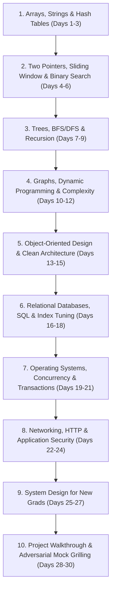

# 15 — 30-Day Master Interview Study Plan for University Graduates & New Grad SWEs

**Target Roles:** Software Engineer (New Grad / University Placement), Entry-Level Backend Engineer  
**Target Companies:** Google (SWE Campus Placement / L3), Microsoft (Software Engineer New Grad), Meta, Amazon, Product Startups  
**Methodology:** 30 Structured Daily Modules balancing Data Structures & Algorithms (DSA), Computer Science Core Fundamentals, VerityVote Repository Deep Dives, and Behavioral Mock Interviews.

---

## 1. The 10 Core Study Pillars

---

## 2. Day-by-Day Detailed Roadmap & Practical Tasks

### Phase 1: Data Structures & Algorithms Foundations (Days 1–12)

- **Day 1: Arrays, String Manipulation & Complexity Fundamentals**
  - *Theory:* Array memory layout, amortized dynamic array resizing, Big-O time and space complexity ($O(1), O(N), O(N^2)$).
  - *Daily DSA Coding Task:* Implement Two Sum ($O(N)$ with hash table) and Valid Anagram.
  - *VerityVote Connection:* Inspect [`Sanitizer.php`](file:///c:/Users/hp/Desktop/Baymax_Voting_System/app/Helpers/Sanitizer.php) to see how string normalization and regex pattern sanitization operate.
  - *Measurable Outcome:* Can write and explain two-pointer string reversals without extra space ($O(1)$ space).

- **Day 2: Hash Tables, Collisions & Constant-Time Lookups**
  - *Theory:* Hash functions, load factors, collision resolution (Chaining vs. Open Addressing).
  - *Daily DSA Coding Task:* Implement Group Anagrams and Top K Frequent Elements.
  - *VerityVote Connection:* Review how [`Cache.php`](file:///c:/Users/hp/Desktop/Baymax_Voting_System/app/Core/Cache.php) computes SHA-256 keys to distribute cached files into a two-character prefix directory structure.
  - *Measurable Outcome:* Explain why average-case hash table lookup is $O(1)$ but worst-case is $O(N)$.

- **Day 3: Sliding Window & Subarray Problems**
  - *Theory:* Fixed vs. dynamic sliding window patterns.
  - *Daily DSA Coding Task:* Longest Substring Without Repeating Characters and Minimum Size Subarray Sum.
  - *VerityVote Connection:* Review login throttling in [`LoginAttemptRepository.php`](file:///c:/Users/hp/Desktop/Baymax_Voting_System/app/Repositories/LoginAttemptRepository.php) to see how rolling time-window lookups are structured in SQL.
  - *Measurable Outcome:* Solve dynamic sliding window problems in $O(N)$ time instead of $O(N^2)$ brute force.

- **Day 4: Two Pointers & In-Place Array Transformations**
  - *Theory:* Left/right pointers, fast/slow runner pointers (Floyd's Cycle-Finding).
  - *Daily DSA Coding Task:* 3Sum ($O(N^2)$) and Container With Most Water.
  - *VerityVote Connection:* Review how pagination arrays are sliced in administrative listing views.
  - *Measurable Outcome:* Confidently prove why 3Sum requires sorting ($O(N \log N)$) upfront to eliminate duplicate triplets.

- **Day 5: Binary Search & Search Space Reduction**
  - *Theory:* Binary search invariants, midpoint calculation to avoid integer overflow (`low + (high - low) / 2`).
  - *Daily DSA Coding Task:* Binary Search on Rotated Sorted Array and Search a 2D Matrix.
  - *VerityVote Connection:* Study B-Tree index traversal in [`03-database-engineering.md`](file:///c:/Users/hp/Desktop/Baymax_Voting_System/docs/interview/phase-14/03-database-engineering.md) to understand why index lookups take $O(\log N)$ disk page reads.
  - *Measurable Outcome:* Correctly write binary search boundaries without off-by-one errors.

- **Day 6: Linked Lists & Pointer Manipulation**
  - *Theory:* Singly vs. doubly linked lists, sentinel dummy heads, cycle detection.
  - *Daily DSA Coding Task:* Reverse Linked List, Merge Two Sorted Lists, and Reorder List.
  - *VerityVote Connection:* Understand why relational database redo logs are organized as sequential append-only linked chains on disk.
  - *Measurable Outcome:* Perform in-place linked list reversal with $O(1)$ auxiliary space.

- **Day 7: Trees, Traversals & Binary Search Trees (BST)**
  - *Theory:* Pre-order, in-order, post-order, and level-order (BFS) traversals; BST properties ($O(H)$ search/insert).
  - *Daily DSA Coding Task:* Invert Binary Tree, Maximum Depth of Binary Tree, and Validate Binary Search Tree.
  - *VerityVote Connection:* Contrast in-memory binary search trees with disk-optimized multi-way B+Trees in InnoDB.
  - *Measurable Outcome:* Implement recursive DFS and iterative queue-based BFS traversals.

- **Day 8: Tree Recursion & Lowest Common Ancestor**
  - *Theory:* Tree divide-and-conquer, path sums, tree diameter.
  - *Daily DSA Coding Task:* Lowest Common Ancestor of a BST and Binary Tree Maximum Path Sum.
  - *VerityVote Connection:* Review hierarchical role boundaries in [`RoleMiddleware.php`](file:///c:/Users/hp/Desktop/Baymax_Voting_System/app/Middleware/RoleMiddleware.php).
  - *Measurable Outcome:* Articulate recursive base cases and bottom-up state propagation.

- **Day 9: Graph Representations & Breadth-First Search (BFS)**
  - *Theory:* Adjacency list vs. adjacency matrix, queue-based traversal, shortest path in unweighted graphs.
  - *Daily DSA Coding Task:* Number of Islands (BFS/DFS) and Rotting Oranges (Multi-source BFS).
  - *VerityVote Connection:* Understand relational foreign key dependency trees and deadlock wait-for graphs in MariaDB.
  - *Measurable Outcome:* Implement graph traversal with visited sets to avoid infinite cycles in $O(V + E)$ time.

- **Day 10: Graph Depth-First Search (DFS) & Topological Sort**
  - *Theory:* Cycle detection in directed graphs, dependency resolution (Kahn's algorithm).
  - *Daily DSA Coding Task:* Course Schedule I & II (Topological Sort).
  - *VerityVote Connection:* Review sequential database schema migration order in [`bin/migrate.php`](file:///c:/Users/hp/Desktop/Baymax_Voting_System/bin/migrate.php).
  - *Measurable Outcome:* Detect cycles in directed graphs using 3-color node state tracking (White, Gray, Black).

- **Day 11: Dynamic Programming Fundamentals (1D Memoization & Tabulation)**
  - *Theory:* Overlapping subproblems, optimal substructure, top-down memoization vs. bottom-up tabulation.
  - *Daily DSA Coding Task:* Climbing Stairs, House Robber, and Coin Change.
  - *VerityVote Connection:* Compare DP subproblem caching with application Read-Aside caching.
  - *Measurable Outcome:* State the recurrence relation and space-optimization from $O(N)$ to $O(1)$ space.

- **Day 12: 2D Dynamic Programming & Interval Problems**
  - *Theory:* 2D grid DP, longest common subsequence, interval scheduling.
  - *Daily DSA Coding Task:* Longest Common Subsequence and Merge Intervals.
  - *VerityVote Connection:* Review election overlapping time window validation in [`ElectionService.php`](file:///c:/Users/hp/Desktop/Baymax_Voting_System/app/Services/ElectionService.php).
  - *Measurable Outcome:* Merge overlapping intervals in $O(N \log N)$ time after sorting by start time.

---

### Phase 2: OOP, Databases & Core CS Fundamentals (Days 13–21)

- **Day 13: Object-Oriented Programming (OOP) & SOLID Principles**
  - *Theory:* Encapsulation, inheritance, polymorphism, and abstraction. The 5 SOLID principles.
  - *Practical Task:* Solve Question Q6 and Q10 in [`10-interview-question-bank.md`](file:///c:/Users/hp/Desktop/Baymax_Voting_System/docs/interview/phase-14/10-interview-question-bank.md).
  - *VerityVote Code Dive:* Contrast [`VotingService.php`](file:///c:/Users/hp/Desktop/Baymax_Voting_System/app/Services/VotingService.php) (SRP: business rules) with [`VotingRepository.php`](file:///c:/Users/hp/Desktop/Baymax_Voting_System/app/Repositories/VotingRepository.php) (SRP: SQL execution).
  - *Measurable Outcome:* Defend why constructor dependency injection is superior to global static singletons for testability.

- **Day 14: Modern Backend Design: Monolith vs. Microservices**
  - *Theory:* Service boundaries, network latency costs, distributed transaction fallacies.
  - *Study Doc:* Read [`02-system-architecture.md`](file:///c:/Users/hp/Desktop/Baymax_Voting_System/docs/interview/phase-14/02-system-architecture.md) (Section 1).
  - *Practical Exercise:* Rehearse the 2-minute elevator pitch from [`01-project-introduction.md`](file:///c:/Users/hp/Desktop/Baymax_Voting_System/docs/interview/phase-14/01-project-introduction.md).
  - *Measurable Outcome:* Articulate 3 concrete disadvantages of microservices for an institutional voting app.

- **Day 15: Relational Schema Design & Foreign Key Actions**
  - *Theory:* Normalization (1NF through 3NF), `ON DELETE RESTRICT` vs. `CASCADE` vs. `SET NULL`.
  - *Study Doc:* Read [`03-database-engineering.md`](file:///c:/Users/hp/Desktop/Baymax_Voting_System/docs/interview/phase-14/03-database-engineering.md).
  - *Practical Task:* Run `bin/check_db.php` and verify foreign key consistency across all 10 tables.
  - *Measurable Outcome:* Explain why `votes` intentionally omits a foreign key to `users` to protect ballot secrecy.

- **Day 16: SQL Indexing Strategies & Query Optimization (`EXPLAIN`)**
  - *Theory:* B+Tree index structures, composite index leftmost prefix rule, index-only covering scans.
  - *Study Doc:* Review Migration 006 in [`006_performance_optimization_indexes.sql`](file:///c:/Users/hp/Desktop/Baymax_Voting_System/database/migrations/006_performance_optimization_indexes.sql).
  - *Practical Task:* Complete Exercise 1 and Exercise 2 in Section 11 of `10-interview-question-bank.md`.
  - *Measurable Outcome:* Explain how Migration 006 eliminated `Using filesort` from candidate directory queries.

- **Day 17: Database Transactions, Isolation Levels & Deadlocks**
  - *Theory:* ACID properties, `READ COMMITTED` vs. `REPEATABLE READ`, row locking (`LOCK IN SHARE MODE` vs. `FOR UPDATE`).
  - *Study Doc:* Read [`04-voting-concurrency.md`](file:///c:/Users/hp/Desktop/Baymax_Voting_System/docs/interview/phase-14/04-voting-concurrency.md).
  - *Practical Task:* Walk through the deadlock retry loop in [`VotingRepository.php`](file:///c:/Users/hp/Desktop/Baymax_Voting_System/app/Repositories/VotingRepository.php#L182) and explain exponential backoff with jitter.
  - *Measurable Outcome:* Answer Question Q1 and Q2 from [`11-adversarial-interview.md`](file:///c:/Users/hp/Desktop/Baymax_Voting_System/docs/interview/phase-14/11-adversarial-interview.md) without stumbling.

- **Day 18: Concurrency Testing Mechanics**
  - *Theory:* Testing race conditions: multi-processing (`proc_open`) vs. multi-connection loops (`Database::createConnection()`).
  - *Study Doc:* Review Section 4 of `04-voting-concurrency.md`.
  - *Practical Task:* Run `tests/run_tests.php` and observe Suite 4 (25 concurrent worker processes).
  - *Measurable Outcome:* Clearly explain the difference between the 25 OS processes test and the 100 connection bursts test.

- **Day 19: Operating Systems: Processes, Threads & File Locking**
  - *Theory:* Virtual memory, context switching overhead, OS file descriptors, kernel `flock()` semantics.
  - *Study Doc:* Read [`06-performance-and-scalability.md`](file:///c:/Users/hp/Desktop/Baymax_Voting_System/docs/interview/phase-14/06-performance-and-scalability.md) (Section 3).
  - *Practical Task:* Inspect anti-stampede mutex locking in [`Cache.php`](file:///c:/Users/hp/Desktop/Baymax_Voting_System/app/Core/Cache.php#L403).
  - *Measurable Outcome:* Explain how `LOCK_EX | LOCK_NB` prevents the thundering herd problem.

- **Day 20: Networking & HTTP Foundations**
  - *Theory:* TCP 3-way handshake, HTTP/1.1 persistent connections, 401 vs. 403 status codes, CORS, and `SameSite` cookies.
  - *Study Doc:* Review Category 5 in `10-interview-question-bank.md`.
  - *Practical Task:* Inspect response headers using `curl.exe -i http://localhost/Baymax_Voting_System/public/health/live`.
  - *Measurable Outcome:* Explain why `parse_url($uri, PHP_URL_PATH)` is necessary for front-controller routing security.

- **Day 21: Application Security & Threat Modeling**
  - *Theory:* OWASP Top 10: SQLi, XSS, CSRF, credential stuffing, and log injection.
  - *Study Doc:* Read [`05-security-engineering.md`](file:///c:/Users/hp/Desktop/Baymax_Voting_System/docs/interview/phase-14/05-security-engineering.md).
  - *Practical Task:* Run `tests/Integration/MasterSecurityTest.php` to verify all 37 automated security checks.
  - *Measurable Outcome:* Explain why separating participation from ballots does *not* prevent administrator correlation attacks.

---

### Phase 3: System Design, Trade-offs & Mock Interview Mastery (Days 22–30)

- **Day 22: The 4-Tier Benchmark Framework**
  - *Theory:* In-process microbenchmarks vs. DB latency vs. service transactions vs. end-to-end HTTP throughput.
  - *Study Doc:* Read Section 1 and Section 2 of `06-performance-and-scalability.md`.
  - *Practical Task:* Explain why 16,326 ops/sec is an in-process cache microbenchmark and not HTTP capacity.
  - *Measurable Outcome:* Confidently articulate the difference between throughput (ops/sec) and latency (ms).

- **Day 23: System Design: 10,000 to 100,000 Voters (Scaling Scenarios 1 & 2)**
  - *Theory:* Vertical vs. horizontal scaling, stateless web pools, centralized Redis caching, read replica lag.
  - *Study Doc:* Read Scenarios 1 and 2 in [`09-system-design-scenarios.md`](file:///c:/Users/hp/Desktop/Baymax_Voting_System/docs/interview/phase-14/09-system-design-scenarios.md).
  - *Practical Task:* Draw the multi-tier Redis + Aurora read-replica architecture diagram on paper.
  - *Measurable Outcome:* State the functional and non-functional requirements for a university election platform.

- **Day 24: System Design: Asynchronous Ingestion & Live Results (Scenarios 3, 4 & 5)**
  - *Theory:* Message queues (Kafka/RabbitMQ) for peak burst buffers, consumer pools, short TTL tally caching.
  - *Study Doc:* Read Scenarios 3, 4, and 5 in `09-system-design-scenarios.md`.
  - *Practical Task:* Draw the sequence diagram for Kafka-buffered ballot ingestion.
  - *Measurable Outcome:* Defend why results caching (TTL 5s) protects the database from 5,000 users refreshing simultaneously.

- **Day 25: Architectural Trade-offs Mastery (The Top 20 Decisions)**
  - *Theory:* Articulating pros, cons, and scale thresholds for key design decisions.
  - *Study Doc:* Read all 20 trade-offs in [`08-engineering-tradeoffs.md`](file:///c:/Users/hp/Desktop/Baymax_Voting_System/docs/interview/phase-14/08-engineering-tradeoffs.md).
  - *Practical Task:* Practice defending: (1) Monolith vs. Microservices, (2) File Cache vs. Redis, (3) Synchronous vs. Asynchronous voting.
  - *Measurable Outcome:* Explain when an alternative architecture (e.g. Redis or Kafka) becomes strictly necessary.

- **Day 26: Reality Check: Implemented vs. Proposed Roadmap**
  - *Study Doc:* Read [`14-implemented-vs-proposed.md`](file:///c:/Users/hp/Desktop/Baymax_Voting_System/docs/interview/phase-14/14-implemented-vs-proposed.md).
  - *Practical Task:* Review every feature in the codebase and verify that you never claim a proposed design is already working code.
  - *Measurable Outcome:* Confidently answer interview questions about future architecture without overstating project progress.

- **Day 27: The 10-Minute Live Project Demonstration**
  - *Practice:* Rehearse the entire 10-minute live demonstration script in [`12-live-demo-runbook.md`](file:///c:/Users/hp/Desktop/Baymax_Voting_System/docs/interview/phase-14/12-live-demo-runbook.md) with a stopwatch.
  - *Practical Task:* Execute the demo locally (environment check, linting, regression suite, portal walkthrough, duplicate-vote rejection, log verification).
  - *Measurable Outcome:* Complete the live demonstration in under 10 minutes without stumbling or encountering errors.

- **Day 28: Adversarial Mock Interview (Part 1: The Grilling)**
  - *Practice:* Answer questions Q1 through Q13 in [`11-adversarial-interview.md`](file:///c:/Users/hp/Desktop/Baymax_Voting_System/docs/interview/phase-14/11-adversarial-interview.md) out loud to a partner or recorded on camera.
  - *Focus:* Tone should be calm, technically grounded, and completely honest about project limitations.

- **Day 29: Adversarial Mock Interview (Part 2: Advanced Edge Cases)**
  - *Practice:* Answer questions Q14 through Q25 in `11-adversarial-interview.md` out loud.
  - *Focus:* Master the explanation of why separating participation from the ballot box does not provide zero-trust anonymity against a root DBA.

- **Day 30: Final Rehearsal & Ready for Google / Microsoft New Grad Interviews**
  - *Deliver:* Full 5-minute architecture walkthrough from [`01-project-introduction.md`](file:///c:/Users/hp/Desktop/Baymax_Voting_System/docs/interview/phase-14/01-project-introduction.md).
  - *Review:* Resume bullets from [`13-resume-and-github-presentation.md`](file:///c:/Users/hp/Desktop/Baymax_Voting_System/docs/interview/phase-14/13-resume-and-github-presentation.md).
  - *Status:* **100% Prepared, Calibrated, and Confident.**
