# VerityVote — Institutional Scalability Architecture & Distributed Systems Roadmap

> **Document Classification:** Engineering Reference / Long-term Systems Architecture  
> **Phase:** 12 — Performance, Scalability, Observability & Distributed Systems  
> **Target Scale:** 500 Voters (Departmental) $\longrightarrow$ 1,000,000+ Voters (Statewide University Consortia)

---

## 1. Architectural Philosophy: The Case Against Premature Distribution

A common anti-pattern in modern software engineering is decomposing applications into distributed microservices prematurely. In an electronic voting platform, this introduces severe hazards:
1. **The Distributed Transaction Fallacy:** Voting requires strict atomicity across user verification, eligibility whitelisting, double-vote recording, and ballot counting. Across separate microservices, achieving this requires Two-Phase Commit (2PC) or Saga patterns, which introduce distributed lock contention, network latency spikes, and partial failure states.
2. **The CAP Theorem Dilemma:** Under network partitioning ($P$), an electoral system **must choose Consistency ($C$) over Availability ($A$)**. An eventually-consistent ballot box that permits temporary double-voting is fundamentally broken.
3. **The Power of the Optimized Modular Monolith:** As proven by our empirical benchmarks, a well-tuned modular monolith on PHP 8.2 and MariaDB 10.4 InnoDB processes over **240 operations/second** and **68 ACID ballot transactions/second** on a single node, comfortably handling campus elections of up to 25,000 voters.

---

## 2. Four-Stage Institutional Scaling Roadmap

```mermaid
flowchart TD
    subgraph Stage1["Stage 1: Optimized Modular Monolith (Current)"]
        S1_Client[Voters & Admins] --> S1_Apache[Apache 2.4 + PHP 8.2]
        S1_Apache --> S1_Cache[(Local SSD Cache)]
        S1_Apache --> S1_DB[(Single MariaDB 10.4 InnoDB)]
    end

    subgraph Stage2["Stage 2: Read/Write Split & Distributed Cache"]
        S2_Client[Voters & Admins] --> S2_Proxy[NGINX Reverse Proxy]
        S2_Proxy --> S2_App[PHP-FPM Worker Pool]
        S2_App --> S2_Redis[(Redis Cluster)]
        S2_App -->|Writes: Ballots & Auth| S2_Primary[(MariaDB Primary)]
        S2_App -->|Reads: Explore & Tallies| S2_Replica[(MariaDB Read Replicas)]
        S2_Primary -.->|Async Replication| S2_Replica
    end

    subgraph Stage3["Stage 3: Containerized Cloud Native (Kubernetes)"]
        S3_Client[Institutional Consortia] --> S3_ALB[AWS ALB / Cloudflare CDN]
        S3_ALB --> S3_K8s[Kubernetes Pods with HPA]
        S3_K8s --> S3_Galera[(MariaDB Galera Multi-Master / Aurora)]
        S3_K8s --> S3_S3[(MinIO / S3 Candidate Media)]
    end
```

---

### Detailed Stage Breakdown

| Stage | Infrastructure Configuration | Voter Capacity | Peak Write Throughput | Trigger Metrics to Graduate |
| :--- | :--- | :---: | :---: | :--- |
| **Stage 1 (Current)** | Single-server Apache 2.4, PHP 8.2, MariaDB 10.4, Local SSD file cache. | Up to 25,000 eligible voters | $\sim 70\text{ tx/s}$ ($4,200\text{ votes/min}$) | CPU $> 75\%$ sustained during peak voting hour, or disk I/O wait $> 15\%$. |
| **Stage 2** | NGINX load balancer, PHP-FPM pool, Redis distributed cache, MariaDB Primary + 2 Read Replicas. | 25,000 to 150,000 voters | $\sim 250\text{ tx/s}$ ($15,000\text{ votes/min}$) | Primary database write replication lag $> 2\text{s}$, or read traffic saturating primary IOPS. |
| **Stage 3** | Kubernetes HPA (10–50 pods), MariaDB Galera Cluster / AWS Aurora multi-AZ, S3/MinIO for media. | 150,000 to 500,000 voters | $\sim 800\text{ tx/s}$ ($48,000\text{ votes/min}$) | Inter-collegiate election volume exceeding single-region cluster limits. |
| **Stage 4** | Event-driven transactional outbox for audit logs, distributed message bus (Kafka/RabbitMQ), Zero-Knowledge tally proofs. | 500,000 to 2,000,000+ voters | $\sim 2,500+\text{ tx/s}$ ($150,000\text{ votes/min}$) | National collegiate or statewide accreditation requirement. |

---

## 3. Transactional Outbox Pattern for Audit Logs (Stage 4 Transition)

When scaling to hundreds of thousands of voters, synchronous audit logging can contend with ballot writes. VerityVote's architecture is prepared for the **Transactional Outbox Pattern**:
1. Within the same atomic transaction as the ballot write, an event entry is inserted into a local `audit_outbox` table.
2. An asynchronous background daemon (or Kafka connector) tails the `audit_outbox` table and streams events to an external immutable ledger or OpenSearch cluster.
3. This achieves **guaranteed at-least-once log delivery** with zero latency impact on the voter.
